# Phase 2.3B — experimental BitChord Android analysis backend

## Status and production boundary

Starting main: `ca7c68295228a150529727d216e42071e995a9dc`, the merge of PR #19.
The merged Phase 2.3A source is reused directly. No second DSP copy was created.

The real C++ DSP is now built into Android APKs and callable through JNI and
`AnalysisEngine`. **Normal production AutoMix still selects the legacy Kotlin
engine and `nearest-time-mono-22050-v1`.** `MusicService`, `AutoMixController`,
planner, gains, decks, EQ sessions, preferences and UI are unchanged. Merely
constructing the native engine does not load its library. There is no public
switch, automatic native job or production comparison pass.

GMS/FOSS JVM tests, real **host JVM JNI execution**, Android app/test APK builds,
four packaged native ABIs and ELF/APK alignment checks passed. The owner's first
SM-S938U / Android 17 native test run finished 14 tests with one failure, in
`correctedAacAndFlacDecodeThroughNativePipeline`. After repair `68dea095`, the
owner reported that this targeted test **passed on the same phone**, covering
both AAC and FLAC through real JNI. A complete rerun of all 14 native and four
decoder tests remains the device regression gate; see PR #20 for subsequent
owner-reported results. No emulator/system image,
KVM or USB device is provisioned here; adb also failed to initialize its default
read-only user directory. No connected-test task or zero-test invocation is
reported as a pass. The owner's four earlier Phase 2.2 phone passes are historical,
not new Android evidence for this backend.

## Implemented architecture

```mermaid
flowchart LR
  S[Existing authorized AnalysisSource] --> D[AndroidWindowDecoder: corrected v3]
  D --> W[DecodedWindow: mono Float32 / 22050 Hz]
  W --> V[Identity, timeline and actual coverage validation]
  V --> E[BitChordNativeAnalysisEngine]
  E --> J[Bounded JNI copy + call-owned control]
  J --> R[Existing BitChord sinc conversion to 11025 Hz]
  R --> N[Existing controlled native tempo DSP]
  N --> M[Validate and add actual sample origin exactly once]
  M --> A[AnalysisResult + typed MusicalEvidence + diagnostics]
```



`AndroidNativeAnalysis.create()` is an explicit internal/test entry point. It
constructs immutable corrected/native and legacy/legacy pipelines. Its
`ExperimentalNativeAnalysis.submit()` runs on a supplied existing
`AnalysisWorkers<ExperimentalAnalysisAttempt>`; it creates no scheduler or
detached thread. Identical active requests are deduplicated by a source/profile
digest and exact requested microseconds. The existing 1/2/4 worker limits,
waiting queue 8 and legacy feature LRU 64 remain unchanged. MediaCodec, JVM/GC
and other platform threads are separate from these analysis-job limits.

Experimental attempts use `cacheable=false`: neither uncertain/native failures
nor a legacy fallback can become a native cache hit. No PCM enters a feature
cache. `effectiveProfile` and `completedCacheKey()` identify the actual successful
backend/preprocessing, including fallback. Existing feature-cache coordinates
are milliseconds; non-millisecond requests return no completed cache key instead
of silently truncating into a collision. Experimental in-flight keys preserve
exact microseconds. Future persistent native caching is not implemented here.

`LegacyPlanningFeatures.require` still rejects native results. No native confidence
or missing key/vocal/phrase data is admitted to a legacy-only planner.

## Source inventory, native build and licenses

Pinned BitChord revision: `fe95bb60aa9cd205cf4ab8bd25a5bec71a595b4f`.
The authoritative DSP remains under `experiments/bitchord-native-analysis`:
`tempo_analysis.cpp`, `resampler.cpp`, `resampler.h` and the declarations-only
`audio_analysis.h`. All vendored hashes, Orchard/BitChord notices and AGPLv3-or-
later terms remain intact. CMake refuses mismatched source hashes.

| Component | Phase 2.3B change |
| --- | --- |
| `app/src/main/cpp/CMakeLists.txt` | Add the prototype as a subdirectory; link its static core into `tinium_automix`; host JNI support for tests |
| `app/src/main/cpp/native_analysis_jni.cpp` | New AGPL Tinium-specific synchronous JNI adapter, no upstream application JNI serializer |
| Prototype `Control` / wrapper | Optional call-owned stage observer for JNI cancellation tests; no DSP arithmetic change |
| Prototype CMake | Optional standalone shared target; disable it/reference/CLI/Python targets in Android builds |
| `NativeDspPacket.kt` | Versioned wire model, lazy loading and per-call control |
| `BitChordNativeAnalysisEngine.kt` | Input/coverage/result validation, typed evidence and absolute timestamp mapping |
| `ExperimentalNativeAnalysis.kt`, `AndroidNativeAnalysis.kt` | Explicit, bounded fallback and corrected decoder selection |
| `AnalysisEngine.kt`, `AutoMixFailures.kt` | Native provenance methods/optional metadata diagnostic and controlled failure categories |
| `app/build.gradle.kts`, ProGuard | Native target, shared test sources, generated license assets and JNI name retention |
| Shared/JVM/Android tests | Generated PCM, real JNI checks, contract/fallback tests, actual codec test paths |
| `scripts/check_automix_native_apks.py` | Actual ABI/ELF/ZIP/symbol/notice inspection |

Build pins were verified: Java 21, Gradle 9.3.1, AGP 9.1.1, Kotlin 2.3.10,
NDK 27.0.12077973, minSdk 26 and compile/target SDK 37. New CMake selection is
3.22.1, compatible with the prototype's >=3.20 requirement; no existing toolchain
was upgraded. Only `tinium_automix` is selected for packaging. Host reference and
benchmark binaries are excluded. The unrelated `cpp/vibrafp` source/build is not
enabled or modified. C++17, private C++ symbols, static libc++ and 16 KB linker
alignment avoid an additional shared-runtime dependency or duplicate DSP library.
No FFT dependency, ONNX, JNI framework or model was added. Native source/license
attributes require LF line endings, preserving pinned hashes and CMake source-
generation anchors on fresh Windows checkouts too.

Both named `Arm64GmsDebug` and `UniversalFossDebug` APKs actually contain
`arm64-v8a`, `armeabi-v7a`, `x86`, `x86_64`. The existing ABI flavor names had
**no ABI filters**; this PR preserves that behavior rather than changing unrelated
packaging. See [packaging evidence](benchmarks/phase23b-apk-packaging.json).

AGPL text, original attribution, source hashes and JNI modifications are generated
into APK assets at `licenses/bitchord-automix/`. ProGuard preserves native entry
names, transport constructor and control polling. The checked source runtime
notice `app/src/main/cpp/NDK-LIBCXX-NOTICE` is the unmodified NDK 27 LLVM prebuilt
toolchain NOTICE (130,424 bytes; SHA-256
`f96f763beb66a7ba7a667647fc64c0226ace875e590c831fdd9579ec1c1d91e1`). It includes
LLVM/libc++ license and legacy dual-license notices. It is overinclusive of host
tools; it does not import their code. JNI/Kotlin/test adapters are AGPLv3-or-later.
Root Tinium licenses and existing lyrics notices were not changed.

The owner's Musixmatch development permission is a **working assumption** for
this phase. The prior investigation is not reopened. Before a public combined
APK, resolve the previously documented permission scope and all applicable
redistribution obligations: preserve notices/license texts, review required
interactive legal/provider credits, and provide corresponding
source/build modifications under applicable GPL/AGPL terms, and assess AGPL
section 13 where relevant. GPLv3 section 13 allows qualifying GPLv3/AGPLv3
combinations; this does not establish permission for independently restricted
material or prove compliance with the reuse conditions. Embedded credits alone
are insufficient. No public release, APK upload or distribution signing occurred.

## JNI protocol and safety

`BitChordNativeBindings` exposes a version handshake and one synchronous analysis
method. Input is a Java FloatArray, explicit rate/channels, `Long` sample origin,
audible-start hint (engine supplies zero), remaining nanoseconds and a call-owned
`NativeCallControl`. The engine requires canonical corrected 22,050 Hz mono
Float32; the raw JNI boundary additionally validates rates 8,000–96,000 Hz for
tests. Native internal processing is pinned to 11,025 Hz, not a public option.
Library loading runs from the native binding's own declaring classloader, including
instrumentation, rather than from a test-APK lambda's potentially different loader.

JNI validates dimensions and size before allocation, then copies at most
3,072,000 floats / 32 seconds in cancellation-aware 4,096-frame chunks. The
canonical engine limit is smaller: 705,600 floats / 32 seconds. There is no pinned
critical array, retained JVM pointer, global reference, native cancellation-handle
registry, native worker or process-global mutable analyzer state. Java objects
and JNIEnv are borrowed only on their current calling thread until return.
Local references are bounded and released with the invocation frame.

The packet constructor is `(Int, String, DoubleArray, DoubleArray, DoubleArray)`.
Protocol schema 1 has 17 named/documented scalars in `NativeDspPacket.kt`, plus
ordered relative beats and heuristic downbeats. Statuses are controlled ASCII
values. Keys/text/audio IDs are not serialized; the old upstream JNI Unicode-key
problem is not imported. Maximum event vector size is 512. A native build-version
handshake must match Kotlin version
`fe95bb60-controlled-v1-jni1-evidence1-internal11025`.

Input validation covers null/empty/oversized PCM, channels/rates, nonfinite samples,
duration, audible start and overflow. Output checks cover schema, counts/rates,
frame-derived durations, finite statistics/timings/BPM/confidence, interval/BPM
agreement, first beat, ordered/in-bounds vectors and downbeat membership. No
sorting, phase rotation, octave correction or beat invention repairs bad output.
The RMS/peak consistency check allows 1e-9 relative accumulation error, while
preserving the measured values. Actual constant-signal experiments produced RMS
about 1e-14–1e-12 above peak from floating-point summation; an exact comparison
would falsely classify those valid packets as technical failures. No musical
confidence threshold is changed, and materially inconsistent statistics fail.

Recoverable C++ exceptions become explicit statuses; pending JVM exceptions are
preserved after RAII cleanup. Kotlin maps missing library/ABI/linkage, memory,
invalid-output, cancellation and deadline conditions into controlled failures.
This cannot recover arbitrary segmentation faults, native memory corruption or
operating-system OOM termination. Sanitizer evidence covers the standalone native
core, not an Android ASan runtime or the JVM/Android system libraries.

## PCM coverage and exact timestamp semantics

The source path is unchanged: authorized Media3/cache DataSource → extractor/
software codec → Phase 2.2 corrected capture/resampler → canonical DecodedWindow.
The native resampler does not replace the corrected decoder or its source-gap
accounting. There is no byte-budget expansion or whole-song analysis workaround.

Native processing requires structurally valid corrected metadata, full **effective
decode interval** and materialized sample coverage, positive accepted source
frames, zero repeated/synthesized timeline frames and no known source gap.
Unknown or incomplete effective coverage fails before JNI. A seek's missing
leading samples remain partial; they are not padded or accepted by lowering a
threshold. EOS alone does not prove coverage. A request extending beyond known
EOS can have full valid effective coverage while requested coverage remains
PARTIAL in metadata; the native input only claims its actual materialized span.

The Phase 2.3B corrected identity was `sinc64-blackman-initial-preroll-mono-22050-v3`.
It preserves the initial extractor position at track start to retain AAC priming
packets; legacy and all nonzero seek positions are unchanged. The historical
`sinc64-blackman-mono-22050-v2` string is reserved as `BANDLIMITED_V2`, never an
alias for v3. Native backend/JNI versions and DSP arithmetic are unchanged; the
preprocessing component of every profile/cache key changes. Old v2 windows are
rejected by a v3 pipeline rather than relabeled. See the device follow-up below.

Phase 3.3 now selects `sinc64-blackman-flacframes-mono-22050-v5`: it retains v4
frame-clock handling and adds corrected compressed-FLAC frame parsing/platform software
codec selection. v2/v3/v4 strings stay reserved and are rejected by the current native
profile. See [the PCM follow-up](AUTOMIX_PCM_DECODING_AND_RESAMPLING.md). The prior
Phase 2.3B device results below describe their original v3 build, not a v5 rerun.

The native packet returns window-relative seconds. Mapping is precisely:

```text
absoluteBeatUs = sampleTimelineStartUs + round(relativeBeatSeconds * 1_000_000)
```

Use the actual sample origin, not requested decode start; add it once with checked
arithmetic. Validate the rounded result against the real sample interval, with
strict ordering. The native DSP's FFT-center correction is already included.
Internal resampling is symmetric/offline and adds no causal timeline delay;
output sample i represents i/11025 seconds. Converted frame count/duration are
validated separately, including an odd input frame's fractional truncation.

## Evidence, failures and fallback

Tempo/beats are INFERRED with `BITCHORD_TEMPO_TRACKER` provenance. Downbeats are
INFERRED `BITCHORD_FOUR_BEAT_BASS_ACCENT`, never verified meter/phrases. The raw
score is `BITCHORD_UNCALIBRATED_CONFIDENCE`; phase confidence, tempo stability,
grid support, key, vocal and energy-curve fields remain UNAVAILABLE. RMS/peak
are measured on supplied PCM. Exact-silence/zero-tempo results complete with no
trusted musical grid; raw status/score remain in `nativeDiagnostic` for auditing.
Half/double-time values are explicitly unverified, unscored hypotheses.

Low confidence, metrical ambiguity and non-rhythmic false positives are analytical
uncertainty, **not technical failures**. They do not trigger a Kotlin retry, change
the legacy 0.65 gate or become permission to schedule a mix. Diagnostics include
backend/profile/version, actual outcome, native timing/counts and controlled
failure code. No private source strings, song titles, audio or credentials are
recorded. These metrics stay internal/test-only; normal Stats/export UI is unchanged
and no ordinary-listening native log stream is started.

Explicit experimental fallback allows one legacy attempt for missing/version-
mismatched/linkage-failed libraries, null/invalid native output or internal errors.
It uses a **new legacy decode**, original request/source authorization and original
deadline/cancellation. Result backend, preprocessing and completed cache key are
honestly legacy. No fallback occurs for cancellation, timeout, memory pressure,
invalid input, partial/unknown coverage, source/decoder errors or uncertain music.
No recursive retry. Cancellation/deadline wins even if a technical error races it.
At most two bounded decodes occur in an eligible experimental attempt (each keeps
the existing 3 MiB remote / 12 MiB cached budget); normal playback does not use it.

Control polling happens inside PCM transfer, validation, resampling and native
FFT/normalization/correlation/phase/tracking loops. The JVM's absolute deadline
is not assumed to share a C++ clock epoch: pass a bounded remaining duration,
apply steady_clock on native entry, and poll AnalysisControl on the same worker.
The prototype also keeps its 10-second processing cap. Canceled outputs clear
evidence; pipeline postchecks and canceled futures cannot publish cached success.
The stage observer exists for deterministic test handoffs, not a production wait.

## Validation and observed measurements

[Machine-readable validation](benchmarks/phase23b-validation.json) distinguishes
builds, actual host JNI execution and unavailable Android runtime tests.

- Focused AutoMix/effects: **227 tests per variant, 454 total; 0 failures/errors/
  skips**, on GMS and FOSS. This includes the existing 196 per variant, 21 new
  mapping/fallback tests and 10 real host-JNI tests per variant.
- Actual host JNI loads the compiled shared library, verifies version, executes
  all seven BPM fixtures, tests 30 ms one-to-one beat matching, large/fractional
  origins, silence/chord uncertainty, raw input errors, mid-DSP cancellation,
  native deadlines, repeated calls and four independent workers. It also checks
  cancel-one/keep-another and real worker shutdown during DSP.
- Standalone native Release: **10/10 CTest**, including 8 native suites / 365
  assertions, 13 Python tests and provenance validation. Same **10/10** pass with
  ASan/UBSan/LSan, without suppressing findings.
- Rerun of all **90** standalone cases matches original DSP and preserves Phase
  2.3A fingerprint `f917ce89871ca084b9f97f098dc1e03da5e2ee06cd15b661fc0918f1fb8fb000`.
  Concurrent build-load timings from that rerun are not used as new benchmarks.
- Both app debug APKs and both instrumentation APKs assembled. Native test class
  has **14 tests**, old decoder class **4**, compiled for both variants. Neither
  Android class executed here. The four old tests and fixtures are unchanged.
- All four native ABIs are actually compiled/packaged; actual extracted JNI
  symbols, ELF >=16 KB PT_LOAD alignment, uncompressed native ZIP offsets and
  whole-APK `zipalign -c -P 16 -v 4` pass. License asset bytes match source.

| Ground truth | Host JNI BPM | Matched/expected/detected within 30 ms |
| --- | --- | --- |
| 90 | 90.045 | 42/42/42 |
| 107 | 107.094 | 50/50/50 |
| 120 | 120.035 | 56/56/56 |
| 128 | 128.094 | 60/60/60 |
| 140 | 139.981 | 65/65/65 |
| 150 | 149.926 | 70/70/70 |
| 174 | 173.903 | 81/81/81 |

These simple 30-second kick fixtures match Phase 2.3A's host results, not the
different historical Phase 1 corpus. Native core's broader 34/36 within-2% and
remaining half-time/other errors are unchanged. Host JNI stationary chord still
returns about 89.064 BPM / score 0.373: visible false-positive evidence. No Android
BPM differences or real-song/listening quality have been measured.

Observed host JNI engine round trips for these fixtures were about 152–176 ms;
native API measurements were about 151–174 ms. The difference includes bounded
JNI copy/transport, Kotlin validation and possible loading, not an isolated copy
benchmark. Cancel-to-return observations were 262 us / 299 us (one per variant),
after 100 tempo-stage checkpoints. Cold Android library loading, battery usage,
Android peak heap/native memory and worst-case latency remain unmeasured. Host
JUnit timings include development-machine contention and are not phone guarantees.

### Memory and APK impact

For a canonical 32-second job, calculated payloads are 2,822,400 bytes Java PCM,
2,822,400 JNI input copy, 1,411,200 internal PCM, about 262 KB native kernel plus
bounded FFT/envelope/grid allocations. Returned vectors are <=512 events each.
The corrected decoder can additionally hold 6,144,000 mono source bytes at 48 kHz
or 24,576,000 at its existing 192 kHz maximum, plus its Kotlin filter table and
codec/cache buffers. Some Java source storage is eligible for GC before analysis;
do not assume it has already been collected. Four jobs multiply live job payloads;
the app/JVM/MediaCodec/GC add more. No Android peak-memory claim follows from
Phase 2.3A's Linux RSS. No PCM is cached after completion, and native vectors
release synchronously by RAII. Allocation failure does not start a second decode.

Current debug APKs contain 1,702,932 bytes of new JNI library payload across four
ABIs, plus notices: **1,737,706 bytes (1.66 MiB)** added ZIP-entry payload. This is
not a controlled whole-APK before/after size comparison: DEX, ZIP alignment,
signatures and compression metadata are excluded. Current complete APK bytes
and every extracted library hash/size are in packaging JSON. Test-only generated
audio adds about 1.13 MiB to instrumentation assets, not to the application APK.

## Exact validation commands used

Cloud host uses JDK/SDK activation and pinned installed CMake:

```sh
source /workspace/onboarding/activate.sh
/workspace/toolchains/native-host/cmake/data/bin/cmake -S app/src/main/cpp -B /tmp/tinium-android-jni-host -DCMAKE_BUILD_TYPE=Release
/workspace/toolchains/native-host/cmake/data/bin/cmake --build /tmp/tinium-android-jni-host -j4
bash gradlew :app:assembleArm64GmsDebug :app:assembleUniversalFossDebug :app:assembleArm64GmsDebugAndroidTest :app:assembleUniversalFossDebugAndroidTest :app:testArm64GmsDebugUnitTest :app:testUniversalFossDebugUnitTest --tests 'com.music.vivi.playback.automix.*' --tests 'com.music.vivi.playback.effects.*' "-PautomixNativeHostLibrary=/tmp/tinium-android-jni-host/libtinium_automix.so" "-PautomixDecoderTests=true" --no-configuration-cache --no-daemon --max-workers=4
/workspace/toolchains/native-host/cmake/data/bin/cmake --build /tmp/tinium-native-build -j4
/workspace/toolchains/native-host/cmake/data/bin/ctest --test-dir /tmp/tinium-native-build --output-on-failure -V
/workspace/toolchains/native-host/cmake/data/bin/cmake --build /tmp/tinium-native-sanitized -j4
ASAN_OPTIONS=detect_leaks=1:halt_on_error=1 UBSAN_OPTIONS=halt_on_error=1:print_stacktrace=1 /workspace/toolchains/native-host/cmake/data/bin/ctest --test-dir /tmp/tinium-native-sanitized --output-on-failure -V
python3 experiments/bitchord-native-analysis/tools/benchmark.py --build /tmp/tinium-native-build --corpus /tmp/tinium-native-corpus-repeat --output /tmp/tinium-phase23b-parity
python3 scripts/check_automix_native_apks.py --readelf /workspace/android-sdk/ndk/27.0.12077973/toolchains/llvm/prebuilt/linux-x86_64/bin/llvm-readelf --zipalign /workspace/android-sdk/build-tools/36.0.0/zipalign --output docs/benchmarks/phase23b-apk-packaging.json app/build/outputs/apk/arm64Gms/debug/app-arm64-gms-debug.apk app/build/outputs/apk/universalFoss/debug/app-universal-foss-debug.apk
```

Standalone build prerequisites/configure commands are in the Phase 2.3A README.
Without `automixNativeHostLibrary`, the 10 optional host-JNI tests explicitly
report skipped; mapping/legacy tests do not require a native library. Android
tests never use that host property and fail, rather than skip, if JNI is missing.
The host property supplies the test JVM's library search directory; the library
file is a declared Gradle test input, so rebuilding it at the same path invalidates
test results instead of incorrectly leaving JNI tests up-to-date.
No release signing credential was used. Local app/test APK assembly uses the
repository's existing standard debug signing; no distribution APK was signed,
uploaded or published. Release builds, R8 runtime and Android installation remain
outside the executed matrix; JNI keep rules were inspected, not device-validated.

## Samsung Galaxy S25 Ultra / Android 17

Check out this PR branch and use Android Studio Terminal with PowerShell, from
the repository root. Keep the existing debug-keystore setup that passed Phase
2.2. Enable USB debugging, connect/unlock the phone and accept its authorization
prompt. Select the phone if more than one Android runtime is connected.
The first native build needs NDK **27.0.12077973** and CMake **3.22.1**. If Gradle
cannot install them automatically, use Android Studio's SDK Manager → SDK Tools
→ Show Package Details to install these exact versions and accept SDK licenses.
You do not need to enable AutoMix or change any appearance setting for these tests.
If an existing Windows checkout reports a pinned-source hash mismatch, inspect
`git ls-files --eol experiments/bitchord-native-analysis/vendor/bitchord/`. Do not
change source/checksums to bypass it: a fresh checkout of this branch applies the
new LF attributes. Preserve existing edits and signing keys; avoid hard resets.

Run the **14 native integration tests**:

```powershell
.\gradlew.bat :app:connectedArm64GmsDebugAndroidTest "-PautomixDecoderTests=true" "-Pandroid.testInstrumentationRunnerArguments.class=com.music.vivi.playback.automix.BitChordNativeAnalysisInstrumentedTest" --no-configuration-cache --no-daemon --stacktrace
```

Then rerun the **four unchanged decoder tests**:

```powershell
.\gradlew.bat :app:connectedArm64GmsDebugAndroidTest "-PautomixDecoderTests=true" "-Pandroid.testInstrumentationRunnerArguments.class=com.music.vivi.playback.automix.AndroidWindowDecoderInstrumentedTest" --no-configuration-cache --no-daemon --stacktrace
```

Quote each complete dotted `-P` argument; this avoids the previously diagnosed
PowerShell/protobuf `android` property collision. Successful compilation alone is
not success: require the selected class, 14/4 actual tests respectively, zero
failed/skipped tests and `BUILD SUCCESSFUL`. Seven BPM fixtures run inside one
test method. Open the HTML report path printed by Gradle under
`app/build/reports/androidTests/connected/`; retain XML/results and controlled
`NATIVE_JNI_METRIC`, `NATIVE_JNI_CANCEL`, `NATIVE_JNI_NEGATIVE`,
`NATIVE_ANDROID_CODEC` output if a test fails. No unrestricted logcat export is
needed. Report the failing method, controlled status, ABI and timings.

For the currently failing codec integration case alone (one test, both assets):

```powershell
.\gradlew.bat :app:connectedArm64GmsDebugAndroidTest "-PautomixDecoderTests=true" "-Pandroid.testInstrumentationRunnerArguments.class=com.music.vivi.playback.automix.BitChordNativeAnalysisInstrumentedTest#correctedAacAndFlacDecodeThroughNativePipeline" --no-configuration-cache --no-daemon --stacktrace
```

The test now attaches `NATIVE_ANDROID_CODEC` details to its assertion: generated
asset name, actual sample interval/origin, requested/effective/accepted regions,
codec PTS/frame counts, EOS versus request-boundary termination, and preprocessing.
JUnit's `ErrorCollector` attempts both AAC and FLAC even if one fails, then fails
the test for every failed assertion. No partial-coverage acceptance, timestamp
substitution, smaller request or decoder policy change is made.

The initial report established `INPUT_VALIDATION/INSUFFICIENT_AUDIO_DATA/
PARTIAL_SOURCE_COVERAGE` before JNI, not a DSP failure. The old loop attempted
AAC first and aborted before FLAC. Both committed generated assets are 30 seconds
according to host FFprobe; the requested interval is 0..24 seconds. That rules out
the request deliberately extending beyond the fixture's container duration, but
does not establish the actual Android decoded head/tail. That original failure
contained no source coverage/PTS fields. The expanded rerun subsequently supplied
the geometry below. Preserve both per-asset lines from further reruns. Normal
production (legacy) decoding and the strict coverage gate are unchanged.

Cloud validation of this diagnostic-only update: Android instrumentation Kotlin
compiles for Arm64 GMS and Universal FOSS (the native class still has 14 tests).
Both full JVM suites executed with the host JNI library: 286 tests per variant,
zero failures/errors/skips, including ten real-JNI tests per variant. This does
not resolve or reproduce the phone's codec coverage failure in an Android runtime.

### Device geometry and corrected initial positioning

The owner's diagnostic rerun reported AAC source coverage `21,333..23,999,999 us`,
first codec PTS `21,333 us`, 1,150,976 accepted/codec frames at 48 kHz stereo PCM16,
no gaps/overlaps/repeated/synthesized frames, and
`codecEos=true / inputEnd=REQUEST_BOUNDARY`. Materialized PCM starts at 22,000 us
and has 528,714 frames, ending at 23,999,959 us. Full 24-second PCM would contain
1,152,000 source frames and 529,200 mono output frames. The missing 1,024 source
frames are precisely one AAC access unit: genuinely PARTIAL, not UNKNOWN.
The one-us conservative tail follows from anchoring a rational frame clock at
integer PTS 21,333 instead of fractional 21,333 1/3 us.

The committed AAC fixture has a priming packet at `-21,333 us` (host FFprobe),
with a 1,024-sample skip side datum. The decoder previously called `seekTo(0)`
unconditionally after track selection. Android's MP4 extractor applies the
edit-list media-time shift while seeking, which can skip that initial priming
packet. Encoder-delay trimming is still configured, so an already skipped
priming frame can instead be removed from actual content. Initial reading and
an explicit seek to zero are not equivalent here.

Reference inspection, **not copied code or proof of Samsung's exact OS binary**:
Lineage's AOSP-derived frameworks/av revision
[`f13e44db891bf5caf478062365372a8fbc23e45f`](https://github.com/LineageOS/android_frameworks_av/tree/f13e44db891bf5caf478062365372a8fbc23e45f):
`media/module/extractors/mp4/MPEG4Extractor.cpp` (`getTrackMetaData` publishes
encoder delay/padding; `MPEG4Source::read` adjusts seek time by the edit-list
origin and sets the current sample index), and
`media/libstagefright/NuMediaExtractor.cpp` (`selectTrack` does not seek with its
default -1 start time). Java JNI delegates to that default in frameworks/base
[`155701ba6a05d0061dbab1b9f1bfec2040cf4158`](https://github.com/LineageOS/android_frameworks_base/blob/155701ba6a05d0061dbab1b9f1bfec2040cf4158/media/jni/android_media_MediaExtractor.cpp),
`JMediaExtractor::selectTrack`. These references explain the observed one-frame
loss. The owner subsequently confirmed that the repaired targeted test passed
on the same phone; this does not establish Samsung's exact internal implementation.

`DecoderSeekPolicy` now omits only the unnecessary **corrected, zero-start** seek.
The codec receives the track's real initial packets; corrected capture still
trims actual decoded PCM to the requested interval using unchanged timestamps.
No offset is subtracted, no coverage is invented, and no EOS rule or byte/window/
worker limit is expanded. Nonzero seeks can still produce honestly rejected
partial windows. Legacy retains its original seek behavior and preprocessing ID.

Because input samples can change, the repair uses preprocessing **v3**, not v2.
Resampling/downmix arithmetic is unchanged. Profile, in-flight and completed-cache
identities include v3; tests keep v2/v3 jobs and cache objects separate and reject
a v2 window supplied to the current pipeline. Generated-PCM tests replay the
reported partial geometry without promoting it to FULL, and verify the complete
24-second frame clock independently of Android. The device test still requires
both codecs to return FULL coverage, the exact `0..24,000,000 us` sample interval,
529,200 output frames, valid native BPM/beats and no fabricated audio. Its request
and accuracy assertions were not weakened. The owner confirmed a passing targeted
rerun of repair `68dea095` on the SM-S938U / Android 17. Because this method checks
both codecs, that pass verifies full coverage, exact frame counts and real native
results for both generated assets on that device. It does not establish general
codec, streaming or musical-quality compatibility. All 14 native and four decoder
tests must also pass as the full device regression gate; host tests cannot replace
that execution.

Cloud validation after the v3 correction: **293 tests per full GMS/FOSS JVM suite,
586 total, zero failures/errors/skips**, including ten real host-JNI tests per
variant. Both Android instrumentation Kotlin variants compile. The seven added
tests cover positioning, exact reported/full frame-clock geometry, v2/v3 cache
and in-flight isolation, and stale-v2 window rejection. These are policy/PCM/JVM
checks, not an Android MediaCodec execution. The separate targeted Android pass
above was executed and reported by the owner, not in this cloud environment.

`automixDecoderTests=true` uses the existing isolated
`com.yren411.tinium.decodercheck` test application ID. Normal Tinium's ID is
unchanged. Do **not** uninstall your primary app or overwrite a signing key.
If the isolated test install has a signature conflict, restore the same debug key
used for its previous install. Your supplied key was
`C:\Users\hurta\Tinium-Signing\tinium-debug.jks`; the repository's default debug
configuration reads `%USERPROFILE%\.android\debug.keystore`. Preserve the prior
working local setup. If you choose to uninstall only the isolated decodercheck
app instead, it deletes that test app's data; do not confuse it with Tinium.
No keystore recreation, signing-config change or main-app uninstall is required
by the commands above.

## Gates before Phase 3

First run all 14 native and four decoder tests on the S25 Ultra; investigate any
timing, coverage, ABI, JNI, deadline or cleanup failure without weakening tests.
Measure real Android four-worker memory, cold load/copy/runtime and cancellation;
repeat cached/downloaded and authorized streaming source cases. Inspect release
packaging/R8 in an authorized internal build before distribution.

Next validate on permitted, locally supplied real music with independent beat
annotations and negative controls. Calibrate usable native evidence separately
from the legacy scale; preserve half/double ambiguity and unsupported features.
Only an approved Phase 3 planning adapter may consume it, with deliberate cue,
overlap, deadline, gain and audio-output testing. Preserve existing Media3 decks,
Poweramp sessions, normal Crossfade, settings, timeline marker and Stats/export.
Until those gates are met, no native/corrected production activation or improved
audible AutoMix behavior is claimed.

## PR #20 CI follow-up: completed-result invalidation race

At head `ff0346c3`, [Build PR run 38944756233](https://github.com/yren411/vivi-music-personal/actions/runs/38944756233)
reported 283 FOSS tests, one failure and ten skipped optional host-JNI tests.
`AnalysisPipelineContractsTest.completedResultsAreReusedAfterInvalidationWithoutRepeatingDecode`
failed its object-identity assertion after `cancelAll()`. No test-report artifact
was uploaded by that failed run; its build/lint step was skipped. The separate
GMS debug-build check passed.

This is a pre-existing worker race, not a native confidence or cache-profile
collision. `FutureTask` makes a result available to `get()` before `done()`
publishes it under the worker lock. Invalidation can acquire that lock first,
fail to cancel the already completed future, and clear its tracking entry before
the cache is populated. An immediate resubmission then repeats decoding and
returns a different object. Direct repetition of the original test failed
**35/1,000** times before the fix and **0/1,000** afterwards. A full pre-fix FOSS
run also passed (273 passed, ten skipped), demonstrating why one green run is
insufficient to disprove this race.

`AnalysisWorkers` now retains each task's cacheability and harvests completed
successes while invalidating under that same lock. Failed, canceled and mutable
work remains excluded. A delayed callback only publishes if it still owns its
tracking entry, preventing late publication after invalidation/shutdown. Worker
counts, queue/LRU bounds, profiles, scheduling and backend defaults are unchanged.
The original assertion remains unchanged. Three added tests force delayed
callbacks using the private monitor (test-only reflection, no sleeps or
production hooks): retained successes in all modes, exclusion of mutable/failed
work, and no cache repopulation after close. The first fails against old workers.
Existing canceled-old-generation and actual worker-limit tests remain intact.

Post-fix local validation executed both **full** app unit-test suites with the
real host JNI library: **286 tests per variant, 572 total, zero failures/errors/
skips**. This includes all ten real-JNI tests per variant and production-isolation,
controller, decoder, cache/cancellation and effect-session tests. Native Release
CTest also reran: **10/10 passed**. These are JVM/Linux native executions, not
new Android device tests. The 14-test and four-test phone commands above remain
unchanged.

```bash
bash gradlew :app:testArm64GmsDebugUnitTest :app:testUniversalFossDebugUnitTest \
  "-PautomixNativeHostLibrary=/tmp/tinium-android-jni-host/libtinium_automix.so" \
  --no-configuration-cache --no-daemon --max-workers=4 --console=plain
```

The host library must first be built with the existing CMake instructions above.
Without that opt-in library, CI explicitly skips the ten host-JNI tests; it does
not represent those skips as native runtime coverage.
