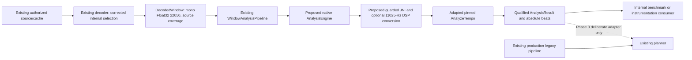

# Phase 2.3 BitChord native analyzer — integration gate and continuation

## Delivery status

**No optional native backend is implemented by this PR.** The revised
[source/licensing reassessment](AUTOMIX_BITCHORD_NATIVE_LICENSING.md) recognizes
`rules.md` as conditional public GPL reuse evidence, correcting the initial
review's omission of a file already present in Tinium. Earlier valid GPL grants
are not automatically revoked by a later header, and GPLv3 section 13 permits
GPL/AGPL combinations; that combination is not itself a blanket blocker.

The remaining question is whether the unchanged reuse rules cover all later
module contributions despite the next-day explicit proprietary relicensing and
retained conflicting notices. Current upstream also has later generic GPL headers
above those notices; Tinium's actual module versions do not. The report identifies
specific rights-holder clarification/provenance work and the exact source/UI
credits needed. Neither document is automatically given precedence, and no
module removal or license/header rewriting is performed.

This revision is the requested **documentation-only reassessment**. Even a resolved
permission interpretation would not authorize native import or app changes during
this task. Phase 2.3 remains incomplete and production stays legacy.

Inspected Tinium main: `e3f1fb2abb8d79f959ee55c687223c26067d53ca`, the merge of
PR #17. Pinned BitChord main after a fresh fetch:
`fe95bb60aa9cd205cf4ab8bd25a5bec71a595b4f`. This matches Phase 1's revision.
The earlier [feasibility audit](BITCHORD_AUTOMIX_PORT_FEASIBILITY.md),
[analysis contracts](AUTOMIX_ANALYSIS_ENGINE_ARCHITECTURE.md), and
[PCM preparation document](AUTOMIX_PCM_DECODING_AND_RESAMPLING.md) remain relevant.

## Current merged implementation: confirmed, unchanged

- `MusicService.AutoMixServiceHost` creates `AndroidWindowDecoder()` and a
  `WindowAnalysisPipeline` with `LegacyKotlinAnalysisEngine`. The decoder's
  immutable `AnalysisPreprocessing.PRODUCTION` remains `LEGACY`.
- Backend remains `tinium-legacy-kotlin`, version `5`; production preprocessing is
  `nearest-time-mono-22050-v1`. Corrected test-selectable preprocessing remains
  `sinc64-blackman-mono-22050-v2`.
- `DecodedWindow` separates requested/effective intervals, accepted source
  coverage and materialized sample origin. `WindowAnalysisPipeline.analyze`
  rejects incomplete or unknown corrected source coverage before analysis.
- `AnalysisProfile.cacheKey` includes backend ID/version, preprocessing version,
  recording/rendition identity, start/length and detail; private identity fields
  are length-prefixed and hashed. No new cache identity or entry is added here.
- `AnalysisWorkers` retains 1/2/4 workers, waiting queue 8, feature LRU 64,
  generation-sensitive caller cancellation and no PCM cache. There is no native
  scheduler or native work in the playback/audio callback.
- `AnalysisResultValidation` checks metadata/backend consistency and qualifies
  malformed evidence. `LegacyPlanningFeatures.require` explicitly rejects a
  nonlegacy backend; it must not be bypassed to make native results reach today's
  planner. Nothing in this PR changes scoring, gains, decks, EQ or user settings.
- Four Phase 2.2 decoder instrumentation methods remain intact. The owner reports
  all four passed on the Samsung Galaxy S25 Ultra/Android 17 before PR #17 merged.
  That is owner-reported device validation of Phase 2.2, not a Phase 2.3 native test.

Current build pins are Gradle 9.3.1, AGP 9.1.1, Kotlin 2.3.10, Java 21, NDK
27.0.12077973, minSdk 26 and compile/targetSdk 37. `app/build.gradle.kts` has no
AutoMix `externalNativeBuild` target. Existing unrelated `vibrafp` source files do
not establish an integrated analyzer or tested native ABI packaging. ABI-named
flavors are universal/arm64/armeabi/x86/x86_64 and currently set architecture labels;
there are no app `abiFilters`. GMS and FOSS share playback and the lyrics dependency.

## Selected upstream algorithm: inspected, not imported

First candidate: `native/analyzer/tempo_analysis.cpp` with necessary declarations
from `audio_analysis.h`. Its standard-library-only `AnalyzeTempo` takes mono float
PCM, sample rate, sample-derived duration and an audible-start offset. It returns
BPM, beat interval, first beat, confidence and owned vectors of beats/downbeats.

The implementation uses a 512-sample Hann FFT with hop 128, positive log-spectral
flux, local-mean suppression, autocorrelation, metrical priors, fractional-lag
refinement and phase-locked beat tracking. Its onset envelope is capped at 1,200 s
and tempo search at 180 s upstream; Tinium must still enforce its own 32-second
window limit, not inherit those larger budgets. The usual upstream analysis rate
is 11,025 Hz. Calling it at 22,050 Hz changes the physical FFT/hop resolution;
validate either choice rather than treating the rate as interchangeable.

The separate `resampler.h/.cpp` is an optional candidate for a documented
22,050→11,025-Hz internal DSP stage. Tinium's corrected source preprocessing should
not be replaced by this upstream implementation. If native internal preprocessing
is chosen, include it in the backend's versioned contract and benchmark its delay,
passband, amplitude and timing separately.

Downbeats are a heuristic choice among four beat offsets using bass/full-band
onset strength, not learned meter or phrase detection. Confidence combines tempo,
phase and candidate-separation scores; no probability calibration or equivalence
to the legacy score has been established. Native source has no deadline or
cooperative cancellation callback in the inspected `AnalyzeTempo` signature.
Those are required adaptations before integration, not capabilities this PR adds.

Do not import `audio_analysis.cpp`, the original JSON/JNI serializer, Kotlin
application wrappers, model frontends, ONNX, vocal assets, DSD/DST or the complete
upstream CMake target for this initial rhythm-only phase. No key/structure result
is needed; unavailable features must stay explicitly unavailable.

## Proposed boundary after licensing clearance — not implemented



The native experimental pipeline must be constructed explicitly in internal tests;
no production load, duplicate background pass, public preference or automatic
selection should be introduced. An initialization error must not prevent ordinary
legacy playback from starting. A legitimate low-confidence native result is a
completed uncertain result, not a technical exception triggering legacy retries.

### JNI and evidence acceptance requirements

1. Accept only supported finite mono Float32 PCM with consistent sample count,
   actual sample duration and known valid coverage. Cap windows/arrays before
   allocation. Reject invalid formats, intervals, partial/unknown source coverage,
   inconsistent profiles and impossible beat-array sizes.
2. Maintain explicit coordinates: native seconds are relative to supplied PCM;
   map each returned beat once to `sampleTimelineStartUs + relativeSeconds*1e6`.
   Check overflow, finiteness, ordering and membership in `sampleInterval`.
   Neither the requested start nor extractor seek timestamp can replace that
   materialized origin. Account for any internal conversion/filter delay.
3. Keep native score provenance separate from `LEGACY_FIXED_GRID`. Add a precise
   evidence method and backend/version; do not invent phase, key or tempo-stability
   scores. Treat heuristic downbeats as inferred and unvalidated. Report octave
   ambiguity as such, without rotating phase or doubling BPM to fit a fixture.
4. Use call-owned buffers, bounded transfers and JNI reference cleanup. Avoid
   long-lived pinned Java arrays. C++ exceptions and recoverable validation/status
   failures require controlled mappings; arbitrary segmentation faults or memory
   corruption cannot be made recoverable just by catching a Kotlin exception.
5. Pass a per-job stop/deadline mechanism and poll inside expensive native loops.
   Checking only before/after a long native call is not cancellation support.
   No detached analysis thread, nested worker future or unbounded retry loop.
6. Technical native failure may fall back once using an explicit legacy job/result
   under its own profile and cache key, preserving cancellation/deadline priority.
   Do not label legacy output as native, copy scores into legacy payload fields,
   mix corrected and legacy preprocessing identities, or recursively retry.

### Build and resource acceptance requirements

After clearance, build from pinned source using the existing NDK; configure a
minimal C++17 target with explicit 16 KB-compatible ELF linking and verify actual
ELF LOAD alignment plus APK native-library ZIP alignment. NDK version alone is
insufficient evidence. Test arm64-v8a, armeabi-v7a, x86 and x86_64 as applicable to
the existing flavors; an arm64 label alone must not silently package every ABI.
Keep GMS/FOSS on the same backend source and retain supported API levels.

Use the existing worker pool, initially no extra native threads. Bound all
native/Java allocations and test four concurrent jobs and cancellation. For
reference only, a 32 s mono 22,050-Hz Float32 array is 705,600 samples/2.69 MiB;
a complete JNI float copy adds another 2.69 MiB, and a 32 s 11,025-Hz float copy
adds 1.35 MiB. These are calculated individual array sizes, **not measured peak
memory**: corrected decoder source buffers, envelopes, codec memory, allocator
retention and the rest of the app are additional. No native timing, APK growth,
initialization overhead or phone battery estimate has been measured in this task.

## Benchmark status and required validation

No native source was imported/compiled or newly benchmarked in this task. The
following is **historical Phase 1 evidence**, not new Phase 2.3 results and not a
promise for the Phase 2.1 LCG fixture generator (its noise differs from the original
NumPy fixture). Compare both backends on the exact same current PCM corpus when
implementation resumes.

| True BPM | Phase 1 legacy BPM | Phase 1 native BPM | Interpretation |
| --- | --- | --- | --- |
| 90 | 60 | 90.040 | Native improvement on that generated fixture |
| 107 | 107.143 | 107.088 | Close estimates; positions/confidence still matter |
| 120 | 120 | 120.031 | BPM alone is not beat accuracy |
| 128 | 85.714 | 128.087 | Native improvement on that generated fixture |
| 140 | 142.857 | 139.972 | Native fractional estimate improves tempo |
| 150 | 150 | 149.920 | Evaluate grid/phase as well as BPM |
| 174 | 176.471 | 87.049 | Native half-time; not automatically corrected |

The audit also observed confidence on stationary chords. Do not interpret its
scores as calibrated reliability or lower production gates. See Phase 1 for its
matched-beat metrics and the exact historical setup; no native F1/runtime figures
are invented here.

When unblocked, use `AnalysisPcmFixtures`, `BeatBenchmark` and
`FutureAnalysisAccuracyTargets` with the actual backend: all seven tempos, phases,
backbeat/hat patterns, leading silence, 120 s drift, silence/noise/chords, sample
rates and incomplete windows. Measure strict one-to-one F1 at 30/70 ms, median/p95
error, drift and half/double-time separately. Add host C++/sanitizer tests, real JNI
instrumentation, invalid output/array tests, availability/fallback, deadline and
cancellation tests, repeated cleanup and all-ABI/16 KB packaging checks. Compare
permitted local music separately without committing copyrighted recordings.

## Initial PR #18 baseline validation

The following baseline ran for the initial documentation-only PR #18, before the
rules.md reassessment. It was **not rerun** for this documentation-only update.
The new review validates Git ancestry/patches, source identities, license wording
and document links; it does not compile, import or test a native implementation.

Previously executed on the cloud Linux/JDK 21 environment:

```sh
bash gradlew :app:testArm64GmsDebugUnitTest --rerun --tests 'com.music.vivi.playback.automix.*' --tests 'com.music.vivi.playback.effects.*' :app:testUniversalFossDebugUnitTest --rerun --tests 'com.music.vivi.playback.automix.*' --tests 'com.music.vivi.playback.effects.*' :app:compileArm64GmsDebugAndroidTestSources :app:compileUniversalFossDebugAndroidTestSources "-PautomixDecoderTests=true" --no-configuration-cache --no-daemon
```

| Check | Actual result |
| --- | --- |
| Existing GMS JVM AutoMix/effects suites | 196 executed, 196 passed, 0 failures/errors/skips |
| Existing FOSS JVM AutoMix/effects suites | 196 executed, 196 passed, 0 failures/errors/skips |
| Existing Android instrumentation compilation prerequisites | Both variants UP-TO-DATE; reused existing compiled outputs, not freshly recompiled |
| Native algorithm/JNI/cancellation benchmarks | Not run: no import/backend permitted past the unresolved license gate |
| New native ABI compilation / ELF and APK alignment | Not run: no native target or packaged artifact was created |
| GMS/FOSS APK assembly | Not attempted for this documentation-only outcome; no APK packaged or signed |
| Android runtime tests in cloud | Not run; no connected Android runtime available |

The two Test tasks were forced to execute with `--rerun`; they were not restored
as passing test runs from a cache. Other valid Gradle outputs were reused (2 tasks
executed, 270 up-to-date; BUILD SUCCESSFUL). These are unchanged baseline tests,
not validation of a native feature. No native test class/PowerShell command is
advertised as implemented.

Existing Phase 2.2 phone tests remain available, without enabling corrected
preprocessing for normal playback. From the checked-out branch in Android Studio's
PowerShell terminal, with the existing debug keystore and phone connected:

```powershell
.\gradlew.bat :app:connectedArm64GmsDebugAndroidTest "-PautomixDecoderTests=true" "-Pandroid.testInstrumentationRunnerArguments.class=com.music.vivi.playback.automix.AndroidWindowDecoderInstrumentedTest" --no-configuration-cache --no-daemon --stacktrace
```

That runs the four existing **decoder** methods; it is not a native backend test.
There is no need to repeat already-passing device tests for documentation changes.
Do not use a hypothetical native class name and mistake a zero-test run for success.

## Continuation checkpoints

1. **Current-version permission and attribution gate:** reconcile the public reuse
   rules with the July-6 relicensing/later contributions, via clarification or
   version-specific GPL provenance. Record applicable permissions and implement
   required visible/source/documentation credits in a separately approved change;
   do not assume module removal or a special GPL/AGPL exception is necessary.
2. **Minimal host algorithm:** import only the cleared inventory with notices and
   source manifest; add cooperative cancellation and generated-corpus tests before
   adding app JNI. Stop if false positives, grid timing or metrical ambiguity cannot
   be represented honestly; keep low-confidence data distinct from failures.
3. **Guarded Android backend:** add bounded JNI, qualified evidence, versioned
   profile/PCM adapters and explicit one-shot legacy fallback tests. Leave
   `MusicService` production selection unchanged.
4. **ABI/resource gate:** compile all intended ABIs, inspect ELF/APK alignment,
   measure native timing/initialization/copies/concurrency/size and verify budgets.
5. **Device gate:** implement and run the real JNI and corrected-decoder tests,
   retain Phase 2.2 tests, and compare locally permitted music on the S25 Ultra.
   Exported diagnostics should identify the actual backend, not imply listening
   quality from a synthetic or compile-only test.
6. **Phase 3 later:** a deliberate native planning adapter, calibrated evidence,
   cue/timing/gain policy and long-overlap execution validation. The existing
   dual-deck/EQ/session architecture remains unchanged in Phase 2.3.

Until these gates pass, **Phase 2.3 remains incomplete** and production stays
legacy. No release, signed APK, version reservation, default change or merge was
performed by this documentation-only work.
