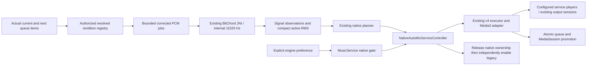

# Experimental Native DJ AutoMix — Phase 3.3

Starting source: `f3c96b1adb7607dbf71bb4c41933010fecb47fc0` (merged PR #22).
The BitChord/Orchard DSP remains pinned to `fe95bb60aa9cd205cf4ab8bd25a5bec71a595b4f`;
no native algorithm, JNI, resampler, musical threshold or distribution configuration was changed.

## Current validation status — Phase 3.3

Native DJ AutoMix is integrated into **MusicService and the normal queue**. Legacy
AutoMix remains the default; the native route requires explicit experimental opt-in.
The implementation is **successfully validated for the tested Android integration
scenarios and ready for experimental review**, not unrestricted production activation.

Reviewed implementation head: **`84a97cba901e1ab98fddfcf95e8fdf941241b4db`**.
PR #23 was verified **open and draft** before this documentation-only reconciliation.
The following results belong to that reviewed implementation, not new executions on
subsequent documentation commits:

| Evidence | Latest verified or reported result | Attribution and limits |
| --- | --- | --- |
| [CI & Debug Build](https://github.com/yren411/vivi-music-personal/actions/runs/39079630570) | Passed on `84a97cba` | Universal GMS job, 9m42s |
| [Build PR](https://github.com/yren411/vivi-music-personal/actions/runs/39079630450) | Passed on `84a97cba` | Universal FOSS job, 13m07s; existing nonblocking lint policy, not clean lint |
| Complete local JVM suites | **497 Arm64 GMS + 497 Universal FOSS = 994 passed**; zero failures/errors/skips | Executed for completion-boundary repair `3d667e36`; subsequent changes through `84a97cba` are documentation/evidence only |
| Actual host JNI | **17 tests per variant**, included in the JVM counts | Real native DSP on Linux; separate from Android execution |
| Combined physical-device instrumentation | **49 executed, zero failures, zero skips**, owner-reported | Samsung Galaxy S25 Ultra, Android 17; all five categories in the same selection |

The duplicate push-only GMS job was conditionally skipped under the existing workflow
rule; that is neither a failed check nor a skipped instrumentation test. The local XML
counts were rechecked during this documentation review; no JVM or Android suite was
rerun solely for these edits. Native CTest/sanitizer results and Android APK compilation
remain separate historical evidence in [the benchmark guide](benchmarks/phase33-native-automix/README.md).
New documentation-head checks must be reported against their own SHA on the PR, rather
than inheriting the two workflow results linked above.

### Owner-reported final combined Android run

| Test suite | Tests passed |
| --- | ---: |
| Corrected PCM decoder | 4 |
| BitChord native analyzer | 14 |
| Native-aware DJ planner | 6 |
| Native DJ transition executor | 14 |
| Native AutoMix MusicService integration | 11 |
| **Total** | **49** |

The owner reports this complete run after updating for the Phase 3.3 completion-boundary
correction. Codex did **not** independently execute it; raw Android test XML and an
independently verified installed commit SHA were not supplied. Targeted repairs addressed
the earlier harness, fixture-cache, readiness, FLAC coverage, callback/history and
successive-transition blockers. Their failed measurements and repair checkpoints remain
below and in unchanged raw benchmark artifacts; their then-pending device statuses are
superseded by this final owner report.

Real-song listening quality, acoustic synchronization, Bluetooth/headphone behavior,
audible Poweramp Equalizer processing and long-term resource/reliability behavior still
require evaluation. No APK release or automatic merge is authorized. Native DJ AutoMix
remains experimental and off by default.

## Phase 3.3.1 decoder follow-up

[Real-world decoder reliability](AUTOMIX_REAL_WORLD_DECODER_RELIABILITY.md) introduces
corrected preprocessing v6 for AAC tail-buffer timestamp ownership, followed by
**`sinc64-blackman-opus-support-mono-22050-v7`** for bounded Opus seek/preroll and
endpoint-support packets. The Phase 3.3 owner-reported 49-test pass and reviewed CI
results above retain their original **v5** provenance; they are not new device validation
of v6/v7. The follow-up keeps the DSP, planner/executor gates, opt-in and legacy default intact.
The owner reported one Opus failure among the ten new decoder methods on v6;
after the v7 repair, the owner reported all 59 combined tests passed on the S25 Ultra /
Android 17 (10 new plus prior 49, zero failures/skips). This later owner report is
separate from the historical v5 run and from Codex host/build results. No raw Android
XML or independently verified installed SHA was supplied. Real-song and acoustic
validation remain outstanding.

## Scope and current evidence

This phase connects the native pipeline to **MusicService and the normal queue**, behind
an explicit experimental opt-in. It adds no second service, output sink, focus requester,
remote flag, telemetry uploader or model. Legacy AutoMix remains the default.

The earlier owner-run 38 Android decoder/native/planner/executor passes were historical
prerequisites. The final combined run above additionally includes all eleven service tests
and reruns those 38 regressions together. Service tests bind the actual service, use its
configured players and generated local files, and execute real corrected decoding/JNI/
planning/execution. Compilation, cloud execution and owner-reported device execution remain
separate evidence in [the evidence directory](benchmarks/phase33-native-automix/README.md).
No real-song, acoustic, Bluetooth, Poweramp or phone battery result is claimed here.

## Architecture and ownership



`NativeAutoMixServiceController` is a main-thread, nonblocking pair coordinator. It uses
`ExperimentalNativePlanningSession`, not a second analyzer/planner implementation.
`NativeAutoMixServiceHost` is the small service boundary for queue/source snapshots,
legacy enablement, execution, control forwarding and status publication. Pure JVM tests
exercise this boundary; Android tests additionally bind `MusicService` itself.

Native selection suspends legacy scheduling before starting a native batch. A legacy
preparation is canceled through its existing controller. Native and legacy never intentionally
hold gain ownership concurrently. No native results are converted into `AutoMixPlan` or
passed through `LegacyPlanningFeatures.require`. On native rejection, the batch closes,
standby/executor ownership is released, and the existing legacy controller can independently
analyze through `nearest-time-mono-22050-v1`. It does not receive native evidence or cues. Legacy fallback retains its existing gain policy;
the experimental quiet-tail safeguards apply only while the native executor owns playback.

`Media3NativeDjPlayback` still defaults to isolated single-item admission. Its explicit
service queue option allows a caller-owned full outgoing playlist with pause-at-end and
exclusive ownership. The executor's plan/readiness/drift/rate/cue guards are unchanged.

## Settings, migration and rollback

Settings → Player and audio → Player → AutoMix → **AutoMix engine**:

- **Legacy AutoMix (default)**.
- **Native DJ AutoMix (experimental)** — attempts beat-synchronized transitions and falls
  back when sources, timing or musical evidence are unsuitable.

The new key is `intelligentAutoMixEngineMode`, with stable values `LEGACY` and
`NATIVE_DJ_EXPERIMENTAL`. Absent/unknown values read as legacy. Existing enablement,
performance and Crossfade keys are unchanged. AutoMix itself remains off for users who
have not enabled it. Crossfade mutual exclusion and saved Crossfade preferences are preserved.
The mode selector is visible only while AutoMix is enabled.

Switching modes invalidates pending work and cancels an active native attempt through the
current executor recovery/cleanup path (v4, retaining v3 timing policies). A healthy current
outgoing deck continues at the current master/focus volume; a completed/promoted incoming primary is never released by old callbacks. Rollback
can be audible, particularly late in a fade; seamless emergency reversal is not promised.
Select Legacy or turn AutoMix off to stop experimentation without reinstalling or erasing data.
Three recorded technical failures suspend further native attempts for the current service
session. The saved selection is not rewritten. Switching to Legacy and back explicitly resets
that safety suspension. Musical unsuitability alone does not trigger the technical-failure limit.

## Two-track planning, coverage and budgets

Analysis starts as soon as the actual current/next pair and its resolved sources are known.
Only that pair is analyzed. Outgoing uses up to the final **32 seconds**; incoming uses up
to its first **32 seconds**. These are bounded candidate regions, not asserted musical outros
or phrases. No full-song PCM is retained. Intro preservation, transient corroboration, beat
alignment, octave ambiguity and all Phase 3.1 gates remain intact.

The original batch deadline is bounded by remaining track time, a 20-second ceiling, and
three times the observed analysis cost (initial estimate two seconds, minimum budget four
seconds). There is no indefinite retry or nested future wait. A caller snapshot updates the
planner's earliest feasible outgoing time while analysis finishes, without decoding again.
The plan reserves two seconds for preparation. Actual standby preparation begins only within
4–10 seconds of the cue, using observed analysis cost as an additional conservative margin.
The actual READY/seek deadline and unchanged executor admission still decide feasibility;
these scheduling estimates are not measured network guarantees.

A bounded rendition registry rejects late resolver publications from an old mode/quality
epoch. Active-pair validity also includes both MediaItems' URI, cache key and MIME, even
when recording IDs remain unchanged; unrelated future queue additions do not invalidate the pair.
Complete downloaded/cache sources and existing authorized next URLs are reused
before any new network resolution, including offline listening.

The service path requests decoder-reported track durations for planning geometry, rather
than treating rounded catalog seconds as exact. Beat/sample coordinates are never shifted
to reconcile duration discrepancies. The renderer must still agree with the resulting source
duration within the existing 1ms allowance. Missing or inconsistent data causes safe fallback.
Full measured source coverage and valid corrected sample origins remain mandatory; repeated,
padded, discontinuous or unknown PCM is not relabeled trustworthy.

Legacy and native keep separate typed feature caches (64 entries each, no persistent PCM).
Existing backend, engine and preprocessing keys remain distinct. Native session keys also
include the signal-observation and active-level method versions. Mutable local files are not
cached as immutable. Completed compatible immutable results remain reusable after cancellation.

Each typed worker pool retains its existing bounded queue (8) and mode size (1/2/4).
A shared `AnalysisConcurrencyBudget` limits actual service work across both pools to the selected
**1/2/4** slots, including cancellation unwinding during fallback/mode changes. Budget waits are
interruptible on workers, never the main/audio thread. Planning is queued only after analyses
finish. There are no detached native threads or additional unbounded schedulers.

## Real sources and rendition provenance

The opt-in route records the actual authorized URI and known format/length when the existing
resolver opens a rendition. Upcoming resolution reuses the immediate-next prefetcher, with the
existing 30-second retry throttle; it does not resolve every future queue item. Signed URLs
remain in memory only. Incoming playback pins the analyzed authorized source and cache key;
it does not silently re-resolve to a different encoding at the cue. Subsequent songs in the
promoted playlist return to the normal resolver. The temporary current-item pin is also
released on successful promotion (or standby disposal), using a thread-visible source holder.
Later opens can therefore refresh an expired authorized URL through the normal resolver;
the analyzed rendition remains pinned throughout transition ownership. Existing cache authorization, byte/window
limits, cancellation and network timeout safeguards are retained.

Only fully cached, known-length data can establish a cached rendition without a URL. Unknown
incoming duration/source, a changed or expired upcoming URL, quality changes, mutable-file
length/mtime changes, DRM/live content, gapless album pairs, repeat-one, nonunity speed/pitch,
silence skipping, casting/shared listening or conflicting deck ownership prevent native execution.
Native mode permits authorized local file URIs through the existing DefaultDataSource and
standard extractors; it does not add a public local-library importer or bypass permissions.
A file's length/mtime is a bounded mutation check, not a cryptographic immutability guarantee.

If native mode is selected while a remote song is already buffered, its actual source may not
be observed until the next authorized resolver open. The system waits/falls back instead of
inventing a rendition identity. For controlled comparison, select the mode **before** starting
the pair. Unsupported providers/renditions may legitimately remain legacy.

AAC priming, FLAC sample origins and PCM coverage use the current corrected decoder
(v6 in Phase 3.3.1; the historical FLAC follow-up below used v5, initial fixtures v3).
There is no new timestamp offset or assumption that differently encoded renditions are sample
identical. Real streaming/container differences and network failure rates remain device work.

## Execution, startup timing, gains and queue promotion

Only `TIMING_AND_TRANSIENT_SUPPORTED` plans execute. Native confidence is not a probability;
unknown vocals/harmony/phrases/meter and octave hypotheses remain visible. No threshold is
lowered and no playback rate is changed to manufacture a supported plan.

The service measures an actual outgoing play command and first observable position progress.
It supplies that observation only with matching source/generation and the v3 validity bounds.
Format-aware prediction still requires known matching prepared formats. Route changes,
seeking, mode/quality changes and relevant player changes discard observations. A coarse or
late observation supplies **zero lead**, never a hardcoded Samsung delay.

The v3 observation expires after ten seconds. Consequently, a transition much later in a long
song will commonly have no valid startup prediction. Independent output startup can then exceed
the unchanged **120ms** drift limit and fall back on some devices. This is an important remaining
limitation, not a reason to reuse stale calibration or widen the limit. Phase 3.4 may need a
separately validated readiness/synchronization improvement. Media3 telemetry is not acoustic sync.

Prepared incoming starts paused at the exact approved cue. Fade progress uses the original
outgoing media anchor; early preparation stays muted. The existing **40ms** command-target
lateness and **120ms** measured drift bounds remain. Overlap duration is not shortened to a
legacy fade. Common progress and stall detection remain independent of clock polling phase.
Pause/resume forwarding handles the fact that normal user controls change the primary's
playWhenReady before the service callback. Reentrancy is guarded while resuming both decks.

Compact active-RMS observations are measured from the same corrected windows and retained
without PCM. The unchanged `NativeDjGain` validates source/preprocessing/overlap comparability,
rejects quiet/unrelated references to unity, caps attenuation at 3dB and never boosts. The
restrained smooth envelope has the existing correlated-source sum guard. Master, mute and
focus gain are applied once; valid content attenuation tapers to unity at completion. This
is not LUFS/perceived-loudness normalization or post-EQ clipping measurement. No new bass,
filter, time-stretch or pitch effect was added.

Promotion revalidates the authoritative pair, inserts the original queue prefix/suffix around
the already-playing incoming item, and preserves its current position. Repeat/shuffle order,
MediaSession, player flow, metadata, sleep timer, notification and widget ownership move once.
The old primary listener is detached and its output is released through the existing service
hook. Pause-at-end prevents outgoing EOS from independently advancing the queue. The service
forwards an explicit END_OF_MEDIA_ITEM notification to the adapter/executor; after failed
end-boundary recovery it releases native ownership before advancing/resuming the existing
queue once. This prevents a pause-at-end failure from permanently parking playback. Completion
is recorded before the next pair invalidates old analysis; no seek-to-zero occurs at promotion.

## Focus, routes and equalizers

The service's configured player/renderers/internal EQ and existing `AudioEffectSessions` /
`AudioOutputLifecycle` remain authoritative. Native output hooks are NONE because the service
already attaches observers before preparation. Promotion/release reuse those hooks; no duplicate
observer/effect chain, forced session ID or incoming focus requester is installed. The service
continues owning ducking, pause/resume, becoming-noisy behavior and preferred output routing.

The new Android tests observe actual session ownership and inject the real service focus
callback and an unexpected end-of-item callback. Injection verifies forwarding/cleanup,
**not OS focus arbitration or an actual truncated-file decoder EOS**. Session OPEN/CLOSE
correctness does not prove Poweramp audibly processes both decks. Speaker, wired and Bluetooth
listening with internal EQ and external EQ on/off must be evaluated separately. Test moderate
EQ changes on the owner device; do not require a Poweramp reinstall/configuration change as a fix.

## Diagnostics and local listening

The existing Appearance → Advanced → Stats for Nerds overlay shows native analysis/planning,
executor stage, selected cues/overlap or explicit native-to-legacy fallback. The existing timeline
marker uses the real native cue and current/next identities. Invalidated plans disappear; native
confidence is never converted into a legacy plan to draw a marker.

Long-press Stats for Nerds to export to Downloads using the existing deliberate export workflow.
The human-readable schema 2 report has an additive **Native DJ extension schema 1**. It includes
selected engine, session-salted track/rendition hashes, generation, backend/preprocessing,
planner/executor versions, both analyzed BPMs and raw native scores (including rejected pairs),
selected tempo hypotheses, uncertainty/readiness, residuals,
plan timing, analysis/preparation time, command lead, sampled drift/progress/gains, terminal
status and controlled fallback reasons. Native summary counters count attempts once, not every
heartbeat. History remains 30 attempts × 128 events; each native event retains only its latest
player sample, not another nested history. No PCM, titles, private paths, URLs, headers or
credentials are exported. No automatic upload or background disk recording is introduced.
Uncollected memory, acoustic, energy and battery metrics remain absent.

For basic listening after installing an appropriate local experimental build:

1. Stop playback in the other Tinium installation. Use a comfortable media volume.
2. Enable AutoMix, choose Native DJ AutoMix (experimental), and optionally enable Stats for
   Nerds and the existing transition marker in Appearance.
3. Start a pair you are authorized to play through Tinium's normal sources/queue. Let the
   current song play; seeking invalidates timing and can intentionally cause fallback.
4. Observe analyzing → plan → preparing/ready → STARTING/MIXING → completion, or an explicit
   rejection/fallback. Read planned cues and overlap; compare the actual player-clock report.
5. Long-press Stats for Nerds to save a redacted report to Downloads. Share that text and a
   voluntary description of what sounded wrong; never upload the audio or unrestricted logcat.
6. Select Legacy AutoMix to compare the same pair, route, volume and EQ settings. Start the
   pair again; preserve similar playback conditions. A longer overlap alone is not better.
7. Return to Legacy or disable AutoMix at any point. No reinstall/data deletion is needed.

A short optional rubric (good / mixed / poor / not assessed): beat alignment, incoming audibility,
outgoing continuity, volume smoothness, vocal clashes, cue/content preservation, overall flow,
stutter/buffering and handoff continuity. Note whether legacy fallback sounded preferable.
Negative reports are useful. Nobody must rate every transition; no ratings/history are uploaded.

Private coverage matrix: same/similar/different BPM; phase differences; half/double-time; vocals;
long intros/outros; quiet→loud and loud→quiet; strong peaks; compressed and dynamic recordings;
electronic/pop/live rock/syncopation; ambient/no percussion; variable tempo; short/long tracks;
FLAC/AAC and mixed renditions; cached/streamed; speaker/wired/Bluetooth; internal EQ and
Poweramp on/off; pause/resume; skip/shuffle; background/screen-off. Use only permitted material,
retain unfavorable cases locally, and distinguish measured timing from subjective ratings.

Classify issues specifically: BPM/octave/phase/grid; cue/content cutoff; vocal/phrase conflict;
overlap suitability; incoming quietness/combined loudness/handoff gain; startup/drift/stall;
source/rendition/cache; session/focus/route; queue promotion/stale work; unknown cause.

## Windows / S25 Ultra commands

Keep the working debug key, for example the already configured
`C:\Users\hurta\Tinium-Signing\tinium-debug.jks`. Do not paste passwords into shared logs.
The existing `-PautomixDecoderTests=true` selects **com.yren411.tinium.decodercheck** for debug
only. It does not overwrite normal com.yren411.tinium or share its preferences/download cache.
An existing isolated installation still needs the same certificate. Resolve signing conflicts
without uninstalling the normal app or erasing data. Select only the intended connected phone.

```powershell
git fetch origin
git switch codex/automix-native-dj-service
git pull --ff-only
.\gradlew.bat :app:connectedArm64GmsDebugAndroidTest --rerun "-PautomixDecoderTests=true" "-Pandroid.injected.androidTest.leaveApksInstalledAfterRun=true" "-Pandroid.testInstrumentationRunnerArguments.class=com.music.vivi.playback.automix.NativeAutoMixServiceInstrumentedTest" --no-configuration-cache --no-daemon --stacktrace
```

New selection: **11 tests, expected 11 executed, zero failures/skips**. It plays generated local
audio using the actual service. Allow several minutes; the repeated-attempt test has a bounded
150-second wait. At least one long native mix must complete; a later unsupported attempt may
legitimately fall back while queue continuity and cleanup remain required. No online provider
or copyrighted fixture is needed. Preferences are snapshotted/restored within the isolated app.

Optional previous **38-test** regression selection (all four original classes; none weakened):

```powershell
.\gradlew.bat :app:connectedArm64GmsDebugAndroidTest --rerun "-PautomixDecoderTests=true" "-Pandroid.injected.androidTest.leaveApksInstalledAfterRun=true" "-Pandroid.testInstrumentationRunnerArguments.class=com.music.vivi.playback.automix.AndroidWindowDecoderInstrumentedTest,com.music.vivi.playback.automix.BitChordNativeAnalysisInstrumentedTest,com.music.vivi.playback.automix.NativeAwarePlannerInstrumentedTest,com.music.vivi.playback.automix.NativeDjExecutionInstrumentedTest" --no-configuration-cache --no-daemon --stacktrace
```

Final combined regression selection: all five categories, **49 tests executed, zero
failures, zero skips** expected. The owner reports this selection passed as summarized
above. These commands remain available for future regression testing, not an outstanding
acceptance blocker. Run only one invocation at a time; generated audio plays.

```powershell
.\gradlew.bat :app:connectedArm64GmsDebugAndroidTest --rerun "-PautomixDecoderTests=true" "-Pandroid.injected.androidTest.leaveApksInstalledAfterRun=true" "-Pandroid.testInstrumentationRunnerArguments.class=com.music.vivi.playback.automix.AndroidWindowDecoderInstrumentedTest,com.music.vivi.playback.automix.BitChordNativeAnalysisInstrumentedTest,com.music.vivi.playback.automix.NativeAwarePlannerInstrumentedTest,com.music.vivi.playback.automix.NativeDjExecutionInstrumentedTest,com.music.vivi.playback.automix.NativeAutoMixServiceInstrumentedTest" --no-configuration-cache --no-daemon --stacktrace
```

To build/install the local isolated app for ordinary listening (not a signed distribution release):

```powershell
.\gradlew.bat :app:installArm64GmsDebug "-PautomixDecoderTests=true" --no-configuration-cache --no-daemon --stacktrace
```

Open the isolated Tinium app and configure authorized sources normally. It has separate data;
this task does not copy accounts, playlists or downloaded files from your normal installation.
No special instrumentation harness is needed for basic queue listening after installation.

On test failure retain actual counts and connected HTML/XML in
`app/build/reports/androidTests/connected/` and `app/build/outputs/androidTest-results/connected/`.
Tests emit `NATIVE_SERVICE_ANDROID` and a sanitized report under tag `TiniumNativeDj`.
For a normal listening failure, export Stats for Nerds and report mode, route, EQ state and
what was heard. Optional controlled log retrieval:

```powershell
$adb = Join-Path $env:LOCALAPPDATA 'Android\Sdk\platform-tools\adb.exe'
& $adb logcat -d -s TiniumNativeDj:I '*:S' > .\phase33-service-diagnostics.txt
```

This command selects the experiment's tag, not unrestricted logcat. Logcat entries can be
truncated. Each service test also overwrites one bounded, sanitized private text report.
To retrieve the last test's report after the retained-APK command above:

```powershell
$report = @(& $adb exec-out run-as com.yren411.tinium.decodercheck cat files/phase33-service-last.txt)
if ($LASTEXITCODE -ne 0 -or -not ($report -match '^Tinium AutoMix diagnostic report')) {
    $report
    throw 'No valid service diagnostic report was retrieved.'
}
$report | Set-Content -Encoding utf8 .\phase33-service-last.txt
```

Subsequent tests overwrite that file. To retain a particular failure, rerun the same command
with the class selector suffixed `#actualFailingMethodName`, then retrieve the report.
The app's deliberate Stats export remains the supported normal-listening report; private
file extraction is optional and does not access the normal Tinium installation.

## Verification, limitations and next phase

Native analysis, planning, dual-deck execution and opt-in MusicService integration are
implemented. Full local JVM/host-JNI validation and the reviewed-head GitHub checks passed;
the owner reports all 49 generated-media Android regressions passed together. Native C++
is unchanged. Codex ran no Android runtime: the cloud had no configured emulator/device,
and compilation is not phone validation. No permitted real-song corpus was available here;
no listening ratings, acoustic results or phone performance are fabricated.

Phase 3.3 exposes experimental usability, not production readiness. Broader activation requires
real authorized-song comparison, repeated queue/controls/background listening, supported-route
focus/session and Poweramp checks, bounded resource observations and correction of common failures. Review
startup synchronization without stale calibration, cue/phrase/vocal suitability and metrical
ambiguity as targeted Phase 3.4 work where real reports justify it. Do not broaden rollout or
weaken timing/coverage gates to raise success counts.

Remaining limitations are not cleared by generated-media regression success:

- **Musical:** some native BPM estimates are wrong; half/double-time ambiguity and
  uncalibrated confidence remain. Reliable vocals, verified phrases and harmonic
  compatibility are unavailable. Cue suitability, intro/outro preservation, perceived
  volume balance and natural longer overlaps need actual-song evaluation.
- **Playback:** startup timing varies by format/route, and observations can expire
  before a late transition. Independent ExoPlayer clocks can separate and legitimately
  trigger drift fallback. Position telemetry does not prove acoustic beat alignment;
  emergency rollback may be audible.
- **Compatibility/resources:** Bluetooth/headphone behavior and audible Poweramp EQ
  processing need listening tests; session-lifecycle assertions do not prove audible EQ
  equivalence. Real streamed/cached sources can differ from generated fixtures.
  Extended-use battery/thermal behavior and long-term reliability remain unmeasured.

GPL/AGPL notices, source provenance and source-distribution obligations remain applicable.
The owner's Musixmatch permission assumption supports this development task; it is not an
independent public redistribution clearance. No lyrics changes, new BitChord import, public
APK, release/version allocation, distribution signing or automatic merge is performed.

## Historical debugging checkpoints — resolved for the tested scenarios

The following sections preserve the sequence of failures, measurements and targeted
repairs. References to pending reruns describe each earlier checkpoint, not current
acceptance status. The final owner-reported 49-test pass above supersedes those runtime
blockers for the tested scenarios; it does not establish the acoustic cause of earlier
crackles or every vendor/route behavior. Raw JSON outcomes remain unchanged. Individual
commands below are optional troubleshooting tools if a regression recurs.

### Device test hangs: bounded harness and progress capture

The owner reported two Phase 3.3 device invocations with audio but no completed test after
approximately seven and three minutes. No matching logcat messages were available, so neither
the stuck method nor the cause of the crackles is established. This is **not** a device pass.

The original service harness could block without a deadline in `runOnMainSync()` and
`waitForIdleSync()`, including cleanup after an already-failed playback assertion. A global
idle wait is inappropriate for a service that schedules work. The follow-up replaces those
calls with test-only bounded Handler/FutureTask calls (7s), bounds preference operations (10s),
and adds a 240s whole-test JUnit limit for the longest 150s progression case plus setup/cleanup.
Existing playback assertions and their 20/50/150s limits are unchanged. Queued timed-out
mutations are removed/canceled; already-running Android platform code is not interrupted or
claimed recoverable. Cleanup attempts remaining steps and preserves the original failure.
A bounded main-thread barrier replaces global idleness; it is not proof of service destruction.

Test/stage/progress markers use `TiniumNativeDj`. Four private files are bounded to the latest
stage, first body failure, latest filtered thread snapshot and latest sanitized AutoMix report:
`phase33-service-progress.txt`, `phase33-service-failure.txt`, `phase33-service-threads.txt`,
`phase33-service-last.txt`. These contain no audio, titles, URLs, credentials or media paths.
Thread snapshots include only the main, ExoPlayer and AutoMix threads (at most 8 × 18 frames).
Progress writes occur on the test thread, not playback callbacks or normal listening.

After stopping a stuck Gradle invocation with Ctrl+C, stop only the isolated test process:

```powershell
$adb = Join-Path $env:LOCALAPPDATA 'Android\Sdk\platform-tools\adb.exe'
& $adb shell am force-stop com.yren411.tinium.decodercheck
```

This does not uninstall either app or erase its data. For optional hang troubleshooting, update the branch and run the
short single legacy-default test, which intentionally starts no audio:

```powershell
git fetch origin
git switch codex/automix-native-dj-service
git pull --ff-only
.\gradlew.bat :app:connectedArm64GmsDebugAndroidTest --rerun "-PautomixDecoderTests=true" "-Pandroid.injected.androidTest.leaveApksInstalledAfterRun=true" "-Pandroid.testInstrumentationRunnerArguments.class=com.music.vivi.playback.automix.NativeAutoMixServiceInstrumentedTest#legacyDefaultDoesNotConstructNativePipeline" --no-configuration-cache --no-daemon --stacktrace
```

Expected: one executed test, zero failures/skips. If it fails, retain the original failure
and suppressed cleanup errors. If the runner itself remains stuck, a second terminal can
read these files while the process is alive, without relying on logcat:

```powershell
$adb = Join-Path $env:LOCALAPPDATA 'Android\Sdk\platform-tools\adb.exe'
& $adb exec-out run-as com.yren411.tinium.decodercheck cat files/phase33-service-progress.txt
& $adb exec-out run-as com.yren411.tinium.decodercheck cat files/phase33-service-failure.txt
& $adb exec-out run-as com.yren411.tinium.decodercheck cat files/phase33-service-threads.txt
```

A failure/threads file may not exist before a failure; compare the recorded test, phase and
run-start timestamp to the current progress file. A missing progress file can indicate that
execution never entered the harness. A blocked Android main thread may also prevent the
framework from finishing the instrumentation invocation despite bounded test waits; stopping
the isolated process is then appropriate after retaining diagnostics. No arbitrary native or
platform deadlock is claimed fixed by a timeout. After the smoke test passes, run the codec
case alone by replacing the selector suffix with
`#actualAacAndFlacSourcesUseThePinnedServiceNativePipeline`, then return to all eleven.

### Confirmed cross-test cache contamination

The bounded driver let the owner complete the single legacy-default test and obtain a real
failure from `actualAacAndFlacSourcesUseThePinnedServiceNativePipeline`. The latter never
reached native planning: corrected decoding rejected EMPTY_OUTPUT/PARTIAL_SOURCE_COVERAGE.
The diagnostics showed 40s, 22,050Hz mono PCM, despite the selected 30s AAC/FLAC assets.

The harness had reused `phase33-generated-0/1/2` as both media IDs and custom cache keys for
WAV, codec, silent and different-duration files across runs. Temporary file URIs alone do
not invalidate Media3's persistent cache. Playback and analysis therefore could consume old
WAV bytes under a codec fixture's key. For the FLAC input's 843,350-byte bound, the cached
WAV header plus PCM yields `(843350 - 44) / 2 = 421653` frames, exactly the decoded count;
`421653 / 22050 = 19.122585s`, exactly the partial coverage. The AAC byte bound (341,588)
is shorter than the stale WAV's 8s seek byte offset (352,844), explaining empty output.

Each harness now uses a fresh UUID namespace for recording IDs **and** cache keys. Those
identities remain stable within its queue; deterministic PCM/beat timing is unchanged.
Cleanup removes only that run's three resources from the service caches, never a whole cache,
another run's resources, normal music or application data. Old fixed-key entries need not be
cleared or the app uninstalled: new runs cannot reuse them. The codec test additionally asserts
actual AAC playback format/duration and both corrected decoder source rates/durations, so wrong
cached material cannot silently satisfy the test. Existing mixing assertions remain required.

This is a test-source identity defect, not evidence that coverage checks or native confidence
should be relaxed. Production cache/decoder/analyzer code was not changed by that repair.
The observed crackles have no established acoustic cause. Reruns were needed at this
checkpoint; the later final combined pass includes the repaired codec and service tests.

### Initial audio-output readiness and configuration diagnostics

After the fixture-ID repair, the owner's codec rerun passed its actual AAC playback
format/duration assertion. Its report showed the intended 30s/48kHz stereo AAC and
30s/44.1kHz mono FLAC during legacy decoding. The stale-WAV problem was no longer
present. However, native admission recorded `UNSUPPORTED_PLAYER_CONFIGURATION` at
391ms, before any native decode/plan, then permanently fell back for that queue pair.
No native mix or successful end-to-end service run is inferred from this report.

The initial admission path could resolve source/duration while Media3 was still
initializing. It checked the legacy host's `allowed` property, which includes
`AutoMixAudioProcessor.isActive`, and latched failure for the pair. An unconfigured
processor is inactive too. A JVM reproduction with an initializing output, transient
processor rejection and subsequently ready output failed before the repair: the
controller rejected rather than retaining eligibility. The broad device reason does
not identify which individual condition was false; the processor timing explanation
is a strong hypothesis for that device attempt, not a measured callback trace.

Native admission now waits for READY playback, an input-format observation belonging
to the current item, and an actual AudioTrack-initialization observation. While waiting,
it leaves ordinary legacy handling available, reports `WAITING_PLAYER_OUTPUT`, starts
no native decode, and does not mark that pair attempted. The same pair can proceed on
an existing service tick after setup completes. This introduces no sleeps, new workers,
forced player changes or arbitrary Samsung timing constant. Queue replacement while
waiting cannot claim the obsolete pair.

Known hard restrictions still reject: casting, Listen Together, silence skipping,
sleep-at-end, live input, unsupported speed/pitch, gapless/repeat-one and competing
deck ownership. After real output setup, an inactive PCM processor still rejects as
`PCM_PROCESSOR_UNAVAILABLE`; it is not bypassed. Native checks now emit specific safe
codes instead of constructing a legacy decoder/pipeline just to read `allowed`.
The legacy host's `allowed` property and default behavior are unchanged. Active
analysis/execution capability checks and all coverage/drift/gain gates are retained.
If output never initializes, normal playback handling remains available; no native
attempt starts. A test timeout now also prints playback state and a controlled status
reason, so this waiting state can be distinguished from a plan rejection.

See `benchmarks/phase33-native-automix/output-readiness-followup.json` for the failing
regression reproduction, post-fix host checks and the then-pending Android rerun.
Later device runs advanced past readiness and exposed the separate FLAC issues below.
Neither the output race repair nor the cache repair establishes the acoustic cause of the previously reported crackles.

### FLAC fractional-frame timestamp repair and v4 provenance

The subsequent owner rerun passed native admission and decoded/analyzed the outgoing AAC
through the actual JNI backend (128.0922879 BPM; raw uncalibrated score 0.9232841).
Incoming FLAC conversion stopped at SOURCE_GAP. Its telemetry reproduces a v3 capture
bug: a roughly 5.8us early buffer PTS was rounded into a whole-frame overlap/drop, then
misreported as a positive source gap. This was reproduced with generated PCM before repair.
The native plan/executor had not run; the subsequent LOW_BEAT_CONFIDENCE belongs to the
separate genuine legacy fallback, not to native evidence.

At that revision, the corrected selector used `sinc64-blackman-preroll-frameclock-mono-22050-v4`.
Sub-half-frame PTS offsets map to the uniquely nearest anchored source frame without
dropping audio. Exact half-frame ties, missing whole frames, unknown/partial coverage,
regressions and unsupported formats still fail safely. Source-frame counts and synthesized
frame accounting remain explicit. Historical v2/v3 profiles cannot share cached or in-flight
results with v4, enter its native engine, or pass planner/executor admission. The legacy
preprocessing and production default remain untouched. Detailed geometry, tests and
version semantics are in [the PCM document](AUTOMIX_PCM_DECODING_AND_RESAMPLING.md).

This fixed a reproduced PCM conversion defect; Android success was not yet established
at this checkpoint. No acoustic alignment, crackle repair or completed native service mix
was claimed from this repair alone. See `benchmarks/phase33-native-automix/flac-frameclock-followup.json` for evidence.

### Historical full-window FLAC EOS blocker: diagnostic follow-up

The owner's next v4 run did not report SOURCE_GAP and again analyzed outgoing AAC at
128.0922879 BPM. Incoming FLAC instead reached actual codec EOS with only 1,317,888
output source frames. Capture retained 1,317,887 after one overlap drop; coverage ended
at 29,884,058us of the requested 30,000,000us. The strict pipeline correctly rejected
PARTIAL_SOURCE_COVERAGE, then prepared genuine legacy fallback. No native plan/mix or
completed fallback handoff is established by this report.

Independent host ffprobe reads all 1,323,000 samples from the original generated FLAC:
287 blocks of 4,608 samples plus a 504-sample tail (288 frames total). The phone codec
output is exactly 286 blocks, 5,112 frames short before the separate one-frame capture
drop. The v4 replay verified the previously reported ~5.8us anomaly, not the phone's
entire unknown packet/PTS sequence. It did not establish full-window codec correctness;
its favorable JVM result must not be substituted for this unfavorable device evidence.

The investigation retained the timestamp policy, strict coverage requirement and full
fixture/window; it did not pad missing audio or label this failed attempt successful.
At this checkpoint it was not yet known whether loss occurred in extraction, the
MediaDataSource bridge, queued input, codec EOS or a source-format-specific path.
Platform extractors may expose FLAC as compressed frames or already-decoded raw PCM; the actual device MIME/codec must be measured.

Decoder diagnostics now append `codecProgressSchema=1`: sanitized extractor MIME and
codec name, declared extractor format, successfully queued data-buffer/byte counts and
first/last PTS/last size, observed extractor end sampleTime, codec data-buffer/byte counts,
first/last output PTS and EOS size/PTS. EOF's negative sampleTime is a sentinel, not a
track position. Counters count different stages independently; encoded bytes are never
presented as PCM frames. No PCM, packet history, paths, source identities or headers are
stored; null means unknown. Existing schema-2 fields/export workflow are retained.
These counters do not change decoding, seek policy, PCM arithmetic or preprocessing v4.

A separate **silent** Android diagnostic executes direct extractor reads with and without
zero seek, then both actual decoder paths on the same generated 30s local FLAC. It starts
no players/service transition and bypasses no service safety gate. It is a decoder probe,
not service end-to-end acceptance. Work is capped (90s overall; per-read/decode deadlines,
1MiB direct packet scratch and at most 1,024 packets / 8MiB read in each extractor probe).
It keeps the full 1,323,000 source-frame / 661,500 output-sample / zero-dropped-frame
requirement, so an assertion failure can be the expected useful reproduction. There is
one test; for optional future troubleshooting, retain the entire `NATIVE_FLAC_EOS` message whether it passes or fails.

```powershell
git fetch origin
git switch codex/automix-native-dj-service
git pull --ff-only
.\gradlew.bat :app:connectedArm64GmsDebugAndroidTest --rerun "-PautomixDecoderTests=true" "-Pandroid.injected.androidTest.leaveApksInstalledAfterRun=true" "-Pandroid.testInstrumentationRunnerArguments.class=com.music.vivi.playback.automix.NativeFlacEosInstrumentedTest" --no-configuration-cache --no-daemon --stacktrace
```

If Gradle truncates the diagnostic, read the bounded generated-fixture-only report:

```powershell
$adb = Join-Path $env:LOCALAPPDATA 'Android\Sdk\platform-tools\adb.exe'
& $adb exec-out run-as com.yren411.tinium.decodercheck cat files/phase33-flac-eos-diagnostic.txt
```

No uninstall/data clearing is required. At this checkpoint the probe, eleven service
tests and previous 38 regressions still needed device execution; compilation was not a
device pass. `benchmarks/phase33-native-automix/flac-eos-diagnostic-followup.json` preserves
that host validation and then-pending phone evidence. The blocker was investigated below
and is superseded for the tested scenarios by the later owner probe/service/49-test passes.
Legacy remains the production default.

### Owner EOS probe: corrected FLAC packet/codec route and preprocessing v5

The owner supplied `probe=v1`, generated October 17, 2026, 1:46pm America/Chicago.
Both direct extractor paths emitted **267 packets / 835,064 bytes** with trailing PTS
zero, and both decoders queued those same bytes to **`c2.sec.flac.decoder`**. Actual
codec output was **1,317,888 frames**, not the fixture's **1,323,000**. Thus compressed
bytes were preserved, while vendor packet framing/PTS and complete decoded output were
not. The exact vendor codec internals remain unknown. This was a software-only codec
according to the selection policy, not evidence of a hardware-codec regression.

The corrected-only v5 route now parses compressed FLAC with the existing **Media3 1.7.1
FlacExtractor** and chooses an available platform software FLAC decoder (`c2.android`
or `OMX.google`). This pairs genuine one-frame packets/header timestamps with a suitable
decoder; it does not guess new timestamps for malformed vendor chunks. A real JVM parser
test yields **288 frames**, including the final 504-sample frame, and verifies compressed
payload byte/order identity by SHA-256. A real 16s seek retains the preceding frame and
reaches the final packet while reading 423,162 bytes. No mock codec is counted as Android
validation. Existing authorized source/range/deadline/worker limits are retained; parser
metadata/frame allocations have explicit bounds. See [the v5 PCM contract](AUTOMIX_PCM_DECODING_AND_RESAMPLING.md).

New corrected profile: **`sinc64-blackman-flacframes-mono-22050-v5`**. v2/v3/v4 IDs stay
reserved; completed and in-flight work cannot cross versions. Legacy remains
`nearest-time-mono-22050-v1` and is still the default. Corrected AAC, resampler, musical
analysis, confidence, gain, drift limits and all service/executor ownership rules are
unchanged. Missing platform FLAC support is a controlled analysis failure with existing
legacy fallback, not an excuse to label incomplete audio valid.

**At the v5 implementation checkpoint, phone validation was pending.** The owner later
reported the silent probe and isolated service codec test passing, followed eventually
by all 49 combined regressions. For optional regression diagnosis, the probe command is
in the preceding section. Expect **one test**, zero failures/skips and no
audio. Its report should begin `NATIVE_FLAC_EOS probe=v2`; corrected diagnostics should
identify preprocessing v5, `extractorImplementation=MEDIA3_FLAC_1_7_1`, a platform codec,
288 input packets, 1,323,000 accepted source frames and 661,500 output samples, with zero
dropped/gap/synthesized frames. Legacy diagnostics may still reproduce the original
vendor shortfall; that path is intentionally unchanged and is not the probe's corrected
coverage assertion. If the probe fails, retrieve the same `phase33-flac-eos-diagnostic.txt`
file; no uninstall, data clearing, new signing configuration or normal app update is needed.

The next diagnostic step at that checkpoint was the single actual-service AAC/FLAC case
(also subsequently reported passing; command retained for optional troubleshooting):

```powershell
.\gradlew.bat :app:connectedArm64GmsDebugAndroidTest --rerun "-PautomixDecoderTests=true" "-Pandroid.injected.androidTest.leaveApksInstalledAfterRun=true" "-Pandroid.testInstrumentationRunnerArguments.class=com.music.vivi.playback.automix.NativeAutoMixServiceInstrumentedTest#actualAacAndFlacSourcesUseThePinnedServiceNativePipeline" --no-configuration-cache --no-daemon --stacktrace
```

That second test plays generated audio and still requires genuine service/native planning
and execution. A passing silent decoder probe alone does not establish service acceptance,
acoustic alignment or a fix for audible crackles. At that checkpoint the full eleven
service tests and earlier 38 regressions were still required; the final combined pass
now covers all 49. `benchmarks/phase33-native-automix/flac-packetization-followup.json`
preserves the then-available host validation and the recommendation to keep the PR draft
until repaired service/device results arrived (see the later suite follow-up below).


V5 code repair: `9a4e5bf9b806a308fb52695c047f2351d81a0177`. After the cloud environment recovered, both complete JVM
suites were explicitly rerun with the rebuilt genuine host JNI library: **487 GMS +
487 FOSS = 974 passed**, zero failures/errors/skips. Current app/test APK outputs and
lint were confirmed up-to-date; earlier compilations are not described as freshly
executed Android tests. Both actual app APKs passed four-ABI ELF/ZIP alignment, JNI
symbol and license-asset checks, with native hashes unchanged. Lint's existing
nonblocking policy is retained (79 pre-existing primary error locations, 777 warnings,
5 hints); no suppressions/workflow changes or clean-lint claim. These checks do not
replace the then-pending phone probe/service validation. Subsequent owner passes are
recorded separately; listening validation remains outstanding.


### Eleven-test suite follow-up: history isolation and playback callbacks

After the v5 repair, the owner reported the silent FLAC probe and the isolated
`actualAacAndFlacSourcesUseThePinnedServiceNativePipeline` case passing on the
S25 Ultra. No raw result XML or independently verified installed SHA accompanied those
reports. The subsequent full eleven-test run had **six failures**; those isolated
passes do not establish full-suite acceptance.

At that checkpoint the six reports exposed confirmed defects and outstanding device
checks. The verification-limit column records the evidence available **then**, before
the subsequent owner-reported combined pass:

| Report | Finding and repair | Verification limit |
| --- | --- | --- |
| Replacing the next track / non-rhythmic fallback expected zero completions but saw one | The harness counted every attempt retained by the service recorder. Test history now starts after disabled routing and an empty queue are acknowledged; completion/planning/rejection/codec assertions share that scope. | Must rerun the complete class on Android. |
| Long-overlap completion wait returned while the outgoing fixture was still current | An earlier test's COMPLETED record could satisfy the wait immediately. The original cue, promotion, overlap-progress, volume and one-output assertions remain intact. | Per-test history tests exercise retained completion records on the JVM; real promotion still needs a phone rerun. |
| Pause/resume main-thread timeout | The service paused an already-resuming primary, then resumed both decks from a Media3 callback. Queued play-state events could repeat that toggle; executor state was published after commands, allowing synchronous reentry as well. Two new regressions failed before repair. | No claim of phone recovery until the owner reruns this method. |
| Successive transitions saw two outputs where one was required | The harness enabled native mode before resetting a potentially retained service queue, and did not await disabled routing before teardown. It now disables/awaits ownership release, clears only the isolated test queue, and then enables the selected mode. | A real output-resource leak is not excluded by the supplied count alone. The strict one-output assertion is unchanged. |
| AAC/FLAC service case passed alone but failed in the suite with LOW_BEAT_CONFIDENCE | Its report retained eleven earlier pairs in one service session and was truncated before the current attempt. Scope reports to this test, reset its queue before activation, and retain unique fixture/cache identities. | The current pair's precise rejection is unavailable in the truncated attachment; do not claim a new codec or confidence fix. |

Executor `tinium-native-dj-executor-v4-reentrant-playback-controls` retains v3's
format-aware startup prediction and independent media-clock progress tracking. It
publishes pause/resume state before deck commands, guards reentrant control/tick calls,
and accepts the primary's already-applied play request **only during explicit resume**.
Queue/source/rate/duration/paused-position and incoming-playing checks still apply.
MusicService forwards the primary's current `playWhenReady` state rather than a queued
stale value and no longer issues the extra pause. Ordinary paused ticks still reject an
unexpectedly playing deck. There is no change to the 15ms cue, 120ms drift, gain, native
confidence, PCM coverage, backend/cache or legacy-default policies.

The Android harness does not assume `stopService` destroys a still-bound MediaSession
service. It awaits disabled routing, clears its generated queue, captures the recorder
session/attempt boundary, then opts in. Teardown awaits disable before clearing the queue
and removing only this test's cache keys/files. It preserves the actual service recorder;
`NativeServiceHistoryScope` exists only in shared test sources and rejects session changes.
No app data, user cache, normal installation or saved owner preference is erased.

Optional targeted regression command for the repaired pause/resume method (generated
audible media; pause normal music and use a comfortable volume):

```powershell
git fetch origin
git switch codex/automix-native-dj-service
git pull --ff-only
.\gradlew.bat :app:connectedArm64GmsDebugAndroidTest --rerun "-PautomixDecoderTests=true" "-Pandroid.injected.androidTest.leaveApksInstalledAfterRun=true" "-Pandroid.testInstrumentationRunnerArguments.class=com.music.vivi.playback.automix.NativeAutoMixServiceInstrumentedTest#pauseResumeVolumeAndInjectedFocusCallbacksReachBothRealDecks" --no-configuration-cache --no-daemon --stacktrace
```

Expect one executed test, no failures or skips. Then rerun all eleven by selecting the
same class without `#pauseResumeVolumeAndInjectedFocusCallbacksReachBothRealDecks`.
The final combined owner pass now includes these eleven and the prior 38 regressions.
Keep the existing debug key and isolated `.decodercheck` package; no normal-app update
or uninstall is required. Retrieve
`files/phase33-service-last.txt` through `adb exec-out run-as com.yren411.tinium.decodercheck`
if the suite fails again; this file now contains only the last test's attempts. A passing
Gradle compile or host-JNI run is not a successful Android playback test.

Repair source commit: `631c62012a242fbb6fe0b19527c256b3c32a3376`. Both full JVM tasks
were explicitly rerun: **496 GMS + 496 FOSS = 992 passed**, zero failures/errors/skips,
including 17 real host-JNI/comparison tests per variant. Nine new unique regressions
cover callback control and retained history. Arm64 GMS and Universal FOSS app/test APKs
compiled; both actual app APKs passed four-ABI ELF/ZIP 16KB alignment, JNI-symbol and
license checks, with native DSP hashes unchanged. Lint is invoked under the existing
nonblocking policy; this is not a clean-lint or Android runtime claim. Structured source,
reproduction, command and test evidence: `benchmarks/phase33-native-automix/service-suite-callback-followup.json`.
The repaired eleven-test Android suite was **unexecuted in the cloud** and phone
regression remained pending at this checkpoint. Codex still has not run Android tests;
subsequent owner-reported passes, culminating in all 49, supply separate physical-device
evidence. Earlier v5 targeted passes remain historical.


### Successive-transition completion boundary

After the callback/history repair (`2e9755e8`), the owner reported that only
`successiveAttemptsPreserveQueueAndReleaseOldPlayers` failed in the full service class:
it saw two outputs immediately after the third queue item became current. The other
previous failures, including AAC/FLAC and pause/resume, were not reported again.

The original wait permitted the second transition to use legacy fallback (it requires
at least one native completion across successive pairs). **Legacy queue promotion occurs
at fade start** in `AutoMixController.drivePreparation`; outgoing release occurs later
in `driveBlend`, followed by bounded level/rate recovery. Native promotion occurs at the
end. Consequently, a queue item change plus an earlier native completion is not a common
completion boundary. Seeing two outputs during that legitimate fallback fade alone does
not prove a leak.

The test now waits for actual transition ownership to become idle, using read-only
`NativeServiceInspection.transitionActive` (native ownership, legacy blend/recovery,
or standard crossfade). It then independently retains the strict one-output, queue,
playing and volume assertions. **It does not wait for outputs to equal one**, increase
the 150-second deadline, release a deck early, disable fallback, or change production
promotion/release behavior. If an unowned output survives completion, the same assertion
still fails and now includes current scoped history/status.

`AutoMixControllerTest.legacyQueuePromotionPrecedesFadeCompletionAndOutgoingRelease`
exercises the real legacy controller with virtual media time: the incoming item is
current while two decks remain owned, then the outgoing deck is released once and only
the continuing incoming deck remains after fade/recovery. This characterizes the
previously incorrect test assumption; it is not a claim of an Android resource-leak fix.
The revised single service test and full combined suite required owner execution at
this checkpoint; both were subsequently reported passing.


Completion-boundary repair source: `3d667e368d950fdd52d995a0299b0f5b5e199f22`.
Both complete JVM tasks executed again: **497 GMS + 497 FOSS = 994 passed**, zero
failures/errors/skips, including the new real legacy-controller regression and 17 actual
host-JNI/comparison tests per variant. Both app/test APKs built (3m44s; 52 executed and
345 up-to-date tasks). The actual app APKs passed four-ABI JNI/ELF/ZIP16KB/license checks;
native hashes are unchanged. Local lint was not rerun for this read-only/test follow-up;
the preceding head's two GitHub workflows and nonblocking lint had passed. Both workflows
subsequently passed on reviewed head `84a97cba`, as linked in the current summary.
No Android tests were executed by Codex. Source/commands/evidence:
`benchmarks/phase33-native-automix/successive-completion-followup.json`.

Optional successive-transition regression command (it uses roughly two minutes of
generated-media playback; its existing wait limit is unchanged):

```powershell
git fetch origin
git switch codex/automix-native-dj-service
git pull --ff-only
.\gradlew.bat :app:connectedArm64GmsDebugAndroidTest --rerun "-PautomixDecoderTests=true" "-Pandroid.injected.androidTest.leaveApksInstalledAfterRun=true" "-Pandroid.testInstrumentationRunnerArguments.class=com.music.vivi.playback.automix.NativeAutoMixServiceInstrumentedTest#successiveAttemptsPreserveQueueAndReleaseOldPlayers" --no-configuration-cache --no-daemon --stacktrace
```

Expect one executed test, no failure/skip. The owner reported this targeted test
passing and then all eleven plus the prior 38 in the final combined invocation.
A persistent extra output after ownership is idle is still a failure; report the expanded
`Successive handoffs` message. No uninstall/data clearing or change to the normal Tinium
installation/signing is needed.
