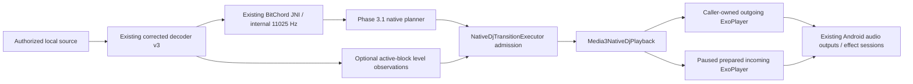

# Experimental native DJ transition execution — Phase 3.2

Base: merged PR #21, `a87611de2188436b7cc951afe4999199210b9d40`.
At the Phase 3.2 checkpoint, this added an **explicitly invoked experimental executor**, not production activation.
`MusicService`, its legacy planner/controller, PCM selection, gains, filters, equalizers,
settings, notifications and queue were unchanged by Phase 3.2. No release version was allocated.

**Owner-reported Android validation passed.** After earlier excessive player-clock drift
and follow-up startup/progress-accounting failures, targeted repairs produced executor
`tinium-native-dj-executor-v3-format-aware-clock-progress`: format-aware startup timing
prediction and independent player-clock progression handling. The owner subsequently
reported that **all 14 `NativeDjExecutionInstrumentedTest` tests passed on the Samsung
Galaxy S25 Ultra running Android 17** after the requested branch update to `b798d833`.
Codex did not execute those Android tests; raw test XML and an independently verified
installed commit SHA were not supplied.

Both substantive GitHub Actions checks passed at reviewed commit
`b798d833da1ea96cb994240e0d3eb8b6ab109677`:
[Universal GMS](https://github.com/yren411/vivi-music-personal/actions/runs/39032420799)
and [Build PR / FOSS](https://github.com/yren411/vivi-music-personal/actions/runs/39032420803).
The duplicate push GMS job was skipped by the existing workflow condition. These are
results for the reviewed implementation, not a claim about future documentation commits.

This validates the reported generated-media player-level tests, **not production listening
readiness**. Acoustic/sample-accurate alignment, comprehensive real-song listening,
Bluetooth/output latency, Poweramp/external-EQ processing and long-term reliability
remain unverified. Normal `MusicService` AutoMix still defaults to legacy. Phase 3.3 now
provides explicit experimental service opt-in, with its own owner-reported 49-test pass;
see [current integration validation](AUTOMIX_NATIVE_DJ_ACTIVATION.md#current-validation-status--phase-33).
That later result does not change the historical Phase 3.2 measurements below.
The historical failures and probe measurements below remain part of the investigation.

## Implemented path



The native source remains pinned to BitChord `fe95bb60aa9cd205cf4ab8bd25a5bec71a595b4f`.
No DSP/JNI/native build source was copied or changed. The actual existing backend is reused.

### Source inventory

- `NativeDjExecutionContracts.kt`: deck/queue/host contracts, states, controlled reasons,
  config and privacy-safe reports. Positions are absolute **track-relative microseconds**.
- `NativeDjTransitionExecutor.kt`: serialized single-attempt coordinator, version
  `tinium-native-dj-executor-v3-format-aware-clock-progress`. No threads, timers, analysis or raw PCM cache.
- `NativeDjGain.kt`: comparable active-block RMS measurements, bounded content adjustment,
  four curve implementations and correlated-signal sum guard.
- `Media3NativeDjPlayback.kt`: actual ExoPlayer adapter, exclusive ownership leases,
  exact-cue preparation, bounded Handler driver, atomic promotion callback and lifecycle hooks.
- `NativeDjExecutionFixtures.kt`: virtual media clocks used only in tests.
- New JVM tests: execution state machine, gain/PCM corpus, real-JNI-to-virtual execution,
  signal/performance reports. Existing tests/assertions remain unchanged.
- `NativeDjStartupTimingTest.kt`: delayed-start predictions, original-anchor drift checks,
  reference validity, expiry, pause and pre-anchor cleanup regressions.
- `NativeDjExecutionInstrumentedTest.kt`: 14 generated-media Android tests.
- `NativeDjLocalListeningInstrumentedTest.kt`: separately selected optional private-file evaluation.
- `NativeDjStartupClockInstrumentedTest.kt`: separately selected, bounded device diagnostic;
  records two seconds of muted incoming playback without approving a transition.

## Production and ownership boundary

Neither the service nor normal AutoMix constructs these classes. There is no public setting,
background native analysis, hidden service or conversion to a legacy `AutoMixPlan`.
The existing `PHASE32_NATIVE_PLAN_EXECUTOR` requirement is checked and satisfied by a real
executor; the planner's gate was not deleted or renamed.

The Media3 adapter receives caller-owned/configured players and promotion/release functions.
It does not resolve streaming URLs, construct a second music service or replace the audio sink.
It requires an isolated single-item outgoing deck and an explicit exclusive-control assertion.
The caller must exclude legacy fade timers. Admission also refuses a player-volume baseline
that differs from current user volume times focus gain, preventing a stale prior fade from
jumping to unity on ownership acquisition. A synchronized ownership registry prevents two
experimental adapters taking the same outgoing/incoming player, including across loopers.
A factory must return a fresh incoming player on the outgoing player's application looper.
The instrumentation harness supplies two real ExoPlayers and an isolated generation/queue,
without touching the user's normal queue or database.

A future service integration can supply its existing media-source/renderers/equalizer factory,
release hooks, authoritative queue snapshot and atomic handoff. **That service wiring is not
installed here.** The controlled isolated path is the current executable integration point.

## Admission and provenance

Admission checks planner version, native backend/profile, corrected preprocessing
`sinc64-blackman-flacframes-mono-22050-v5`, required capability, rate 1.0, generation,
recording/rendition identities, durations, seekability, cue regions, analyzed intervals,
remaining track time, bounded overlap and timing residuals. Pulse counts must be 8/16/32/64
intervals; overlap length, rank summary and predicted rate-1.0 drift must be consistent with
the tempo/alignment fields. A tampered short overlap cannot retain a longer beat grid. Duration
consistency uses the native evidence contract's 2% allowance (at least 70ms); it never changes
a selected cue/duration or relaxes the separate 40/70ms musical residual gates. It rejects nonfinite values and
arithmetic overflow. Native confidence is retained as uncalibrated evidence, never reinterpreted
as the legacy 0.65 confidence scale. Only `TIMING_AND_TRANSIENT_SUPPORTED` proposals are admitted;
`TIMING_ONLY_SIGNAL_UNVERIFIED` receives an explicit rejection.

The producer is the existing Phase 3.1 planner, which validates actual coverage, beats and PCM
provenance. The plan is an internal evidence summary, not a cryptographically authenticated
proof or arbitrary external input format. The executor revalidates that summary and current
playback identity; it does not independently rediscover the beat grid. No partial PCM is relabeled
full coverage. There is no new analysis cache: existing backend/preprocessing/version identity,
worker modes 1/2/4, waiting queue 8 and feature cache 64 are unchanged.

Renderer duration comparison allows at most 1 ms for Media3's millisecond API. Broader catalog,
container or rendition discrepancies are rejected, not silently reconciled. Decoder/renderer
duration disagreement on real sources remains a device-validation concern.

## State machine and scheduling

`IDLE -> VALIDATING -> PREPARING -> ARMED -> [STARTING] -> MIXING -> COMPLETING -> COMPLETED`.
`STARTING` is optional early command dispatch with incoming gain zero before the fade anchor.
Pause remembers its previous state. Terminal alternatives are `CANCELED`, `FALLBACK`, `FAILED`
and `RECOVERED`. One executor handles one attempt; terminal ticks cannot promote/release again.

1. Validate the real outgoing player, then acquire exclusive ownership.
2. Create one paused incoming deck, set `SeekParameters.EXACT`, seek to the selected cue,
   disable repeat/shuffle for this isolated item and prepare asynchronously.
3. Require actual READY, a known compatible duration, seekability, paused state and a position
   within 15 ms of the cue before arming. Millisecond seek quantization is explicit.
4. If the caller supplied a fresh outgoing startup observation **and both prepared audio
   formats are known and compatible**, predict a bounded command
   lead and dispatch incoming `play()` at `outgoingCueUs - startupLeadUs`. Otherwise dispatch
   at the original anchor. The source still starts at the exact selected incoming cue;
   no extra seek, speed adjustment, cue rebasing or synthetic PCM is used. Incoming gain
   remains zero until the original outgoing fade anchor. Polling is 10 ms (250 ms paused,
   immediate rescheduling on resume); more than 40 ms lateness relative to the **command
   target** is rejected as `START_MISSED`, including early commands.
5. Progress the fade using outgoing **media position**, not wall-clock elapsed time. Both player
   positions must progress. Watch for buffering, unexpected pause/EOS, rate changes and jumps.
6. Revalidate generation immediately before the compare-and-promote callback. Promote once,
   release outgoing, clear temporary end-of-item policy, and leave incoming playing at unity
   relative gain. Incoming is never sought to zero during promotion.

Preparation timeout is 10 seconds; preparation must also start with the plan's assumed lead time.
A deck not ready by its command target is not called synchronized. Incoming startup has a 1.5-second ceiling;
observed running media-clock separation must remain within 120 ms. A READY player pair whose
media clocks stop progressing for two seconds returns `PLAYBACK_STALLED`, rather than leaving
a fade/ownership lease alive indefinitely. No speed correction, repeated
seek, time stretching, detached thread or retry loop exists. Future DSP precision must be added
as an explicit capability rather than inferred from a good BPM estimate.

### What timing measurements mean

Reports distinguish command dispatch outgoing position from the first advancing incoming
media-clock estimate. `startupLeadUs` identifies the actual prediction used for dispatch.
Estimated start offset remains `(outPos - outCue) - (inPos - inCue)` at first observed
incoming progression, using the **signed original outgoing anchor**, including pre-anchor
presentation. The lead is never subtracted from measured drift or used to rebase either cue.
Subsequent separation uses the same reference and unchanged 120 ms rejection limit.
`concurrentProgressUs` is the maximum observed common cumulative progression:
`max(previous, min(max(0, outPos-outCue), max(0, inPos-inCue)))`. It uses both
original anchors and excludes pre-anchor muted time. Independently sampled clocks need
not advance on the same polling tick. Each deck has its own unchanged two-second
progress watchdog; first incoming startup retains its separate 1.5-second deadline.
This is a sampled player-level progression proxy, not measured simultaneous rendering,
acoustic overlap or a hardware presentation timestamp.

Maximum tick gap includes the slower paused polling cadence; it is not an audio-render jitter measurement.
The report includes maximum tick gap, preparation elapsed monotonic time, drift, actual command
position and completion/promotions. The 10 ms driver can finish up to one update late under normal
scheduling; a paused process or busy looper can do worse and is observable. Callback/volume calls
are **not sample accurate**. Independent AudioTrack output latency, Bluetooth buffering and
route changes remain important. No acoustic capture was performed in the cloud.

### Measured command lead and its limits

`NativeDjStartupObservation` carries source/generation, monotonic play-command/observation
times, and the actual track positions sampled at those two times. It predicts:

`leadUs = (observedMonotonicUs - commandMonotonicUs) - (observedPositionUs - commandPositionUs)`.

The caller must measure the real outgoing start on the current route using the same configured
player factory. `Media3NativeDjPlayback.startTiming` is an optional input, **absent by default**;
the coordinator samples it once per attempt and retains no cross-session calibration. The
isolated Android harness records the actual outgoing play command, waits for >30 ms of real
player-position progress, then supplies the observation. This is an execution prediction,
not analyzer confidence, measured acoustic latency, or proof that incoming output matches it.

The pure contract requires matching source/generation, nonnegative source position,
1–100 ms observed media progress, 1–500 ms observation elapsed time, age <=10 seconds,
and predicted lead 0–250 ms. Checked subtraction rejects overflow. A reference ahead of
the current outgoing position is ignored. These are resource/validity caps, not a Samsung
constant or a calibrated latency distribution. The reference is rechecked while preparing
and armed; absent, malformed, expired or invalidated observations supply zero lead.
`NativeDjHost.startupTimingCompatible()` defaults to false. The Media3 adapter permits
prediction only when both actual `audioFormat` values are present, with positive matching
sample rate/channel count, a non-null matching sample MIME type, and matching PCM
encoding, codecs, encoder delay and encoder padding. Unknown or mismatched formats
use zero lead and original-anchor dispatch. Equal format fields do not prove equal
hardware startup latency; actual drift validation remains mandatory.
Callers must forward route/seek/queue changes and must not reuse observations after them.
No automatic route-specific cache or device model table is added.

Both the cue and planned overlap remain unchanged. A wrong prediction can cause early or
late source presentation; the executor checks **both signs** against the same 120 ms bound
as soon as incoming progression is observed, even while muted before the fade anchor.
An unavailable reference does not silently get a 120/130 ms guess. Technical readiness,
deadline and progress watchdogs still apply. Confidence gates, analysis/preprocessing cache
identities and production selection are unaffected.

Pause before dispatch discards the unused prediction. Pause during `STARTING` before any
incoming presentation is observed cannot safely preserve pending startup timing: on resume
the executor resumes outgoing music, releases incoming and reports `CANCELED /
STARTUP_INTERRUPTED`, rather than restarting an unverifiable cue. If presentation was already
observed, normal paired pause/resume retains the original clock relationship and drift guards.
The existing Android pause test operates during an established overlap and retains its exact
position/gain freeze assertions. These policies deliberately favor playback continuity over
forcing completion after an ambiguous interruption.

## Gain architecture and quiet-tail correction

Confirmed legacy code: `AutoMixPlanner.plan` computes `quiet=min(localOut,localIn)` and uses
`quiet/localOut` and `quiet/localIn`. A 0.005/0.2 RMS comparison yields an incoming content factor
near 0.025 before envelope/headroom. That is a commanded coefficient, not measured audible output.
The legacy calculation remains unchanged.

Alternatives considered: raw quiet-window ratios repeat the defect; permanent gain changes risk
handoff jumps; unbounded RMS boosts amplify silence/noise. This executor instead uses optional,
source/profile/interval-matched measurements and conservative transition-only attenuation.

`NativeDjLevel.measure` uses 100 ms mono blocks, excludes blocks below max(0.001, 0.1 times the
largest block RMS), and returns the median retained RMS, retained-block fraction and peak.
Version: `active-rms100ms-median-relative20db-v1`. It checks corrected PCM, real coverage and
cancellation. It is **not integrated LUFS or perceived loudness**.

Both observations must cover the selected overlap, have usable active fraction >=25%, active
RMS >=0.01 and finite coherent values. Otherwise content factors are **1.0**. This prevents a
quiet tail, unrelated window, silence or invalid measurement aggressively reducing the incoming
song. Comparable active measurements may attenuate the louder side by **at most 3 dB**, never
boost either track. The content adjustment ramps in/out during the transition; normal playback
returns to unity continuously. No normalization persists after promotion.

```
player.volume = currentUserVolume * currentFocusGain * relativeDeckGain
relativeDeckGain = guardedFadeWeight * [1 - (1 - contentFactor) * sin(pi*p)^2]
```

The Android system volume is never included or changed. PCM processor gain is not also changed,
so this path does not double-apply attenuation. Current user volume is consulted at every gain
update and rollback; a new user value is not overwritten by an old captured volume. After the
lease ends, normal caller volume ownership resumes and old adapter refreshes do nothing.

## Curves and output bounds

Let `s(x)=x*x*(3-2*x)`, `p` be media progress clamped to [0,1]. Raw weights:

| Curve | Incoming | Outgoing |
| --- | --- | --- |
| Linear | p | 1-p |
| Equal power | sin(pi*p/2) | cos(pi*p/2) |
| Smooth S | s(p) | 1-s(p) |
| Restrained DJ (default) | piecewise below | 1-incoming |

Default incoming: `0.42*s(3p)` in the first third; `0.42+0.16*s(3p-1)` in the middle;
`0.58+0.42*s(3p-2)` in the last third. Values and slopes join continuously. It introduces
incoming material sooner than a global smoothstep, holds both near the middle, and completes
without an endpoint jump. It is tunable internally, not claimed perceptually optimal.

All curves divide both raw weights by `max(1, out+in)` before content correction. Thus the
worst-case correlated **normalized** source sum is <=1 without a compressor/limiter or permanent
volume reduction. The equal-power option is therefore correlation-guarded, not an unconditional
constant-power promise. Uncorrelated sources can exhibit an energy dip, which the signal report
retains. Source clipping and subsequent internal/external EQ boosts are outside this mathematical
bound. No post-EQ/Bluetooth clipping or loudness guarantee is claimed.

The current implementation applies player volume automation only. It does not add bass/filter
sweeps or redesign DSP. Musical timing comes from the actual native two-track plan, rather than
extending an end-of-song fade. This phase makes no listening-quality claim.

## Interruptions, handoff and rollback

- Pause/focus loss: caller forwards pause to both decks. Positions and gains freeze; paused time
  does not consume preparation/start timeouts or overlap. Resume revalidates queue/positions.
- Seek/skip/repeat/shuffle/source changes: invalidate before mutation; per-tick generation checks
  also reject stale ownership. No attempt to rebase a running mix silently.
- Noisy-device/route change: forward invalidation; do not assume a previously measured output
  latency remains valid. No device routing override is installed.
- Incoming buffering/error/failed start: cancel experimental playback, release incoming and
  restore current outgoing gain, preserving its play/pause state and position.
- Outgoing failure/EOS: only an already-playing healthy incoming deck with meaningful commanded
  gain may be promoted as **RECOVERED**, with the reason retained. It is not an aligned success.
  EOS exactly at the planned endpoint can complete normally if incoming progression is valid.
- Promotion failure or generation race: no queue advance; release incoming and preserve outgoing.
- Shutdown/close: remove Handler callback, cancel unfinished attempt, restore end policy/lease.
  Successfully promoted incoming remains caller-owned. Cleanup errors are classified, not hidden.

Emergency rollback restores a continuing deck immediately; this is not a sample-smooth recovery
ramp. Pause/seek/route/error recovery may be audible. No recovery launches a simultaneous legacy
fade, fabricates legacy evidence, restarts a track or retries indefinitely. A caller may later
request an independent safe legacy plan after this lease is released.

## Audio focus, sessions and equalizers

The adapter does not make a second focus request. Its caller owns the existing focus policy and
forwards focus gain/loss/ducking plus user controls. The optional listening harness does not automatically arbitrate OS focus or observe every
Bluetooth route selection. Stop/restart it for each output route; its injected control tests
verify forwarding policy, not automatic system-event integration. The isolated generated playback tests use
focus-disabled Media3 players; they test forwarding policies, **not Android focus arbitration**.
For owner listening, pause other music first; there is no foreground production service for this
harness. Real service/focus integration is a future separately validated step.

Caller factories must use a fixed source timeline with silence skipping disabled (the isolated
test factory does), no live/DRM source and unity pitch/speed. Future service admission must retain
its existing incompatibility checks; this experimental adapter is not a generic replacement for
all service playback modes. Factories should disable offload for concurrent volume automation (the test factory reuses
`Player.setOffloadEnabled(false)`), retain their intended renderers/internal EQ, and supply actual
release/promotion hooks. No output-session ID is forced or equalizer reset. `NativeDjAudioOutputs`
reuses existing `AudioEffectSessions`/`AudioOutputLifecycle` with real AudioTrack callbacks and
public OPEN/CLOSE broadcasts, including shared-ID reference ownership. Attach **before prepare**;
READY alone never fabricates AudioTrack ownership. A service already observing sessions must use
its existing hooks, not attach a duplicate observer/effects chain.

The instrumentation suite checks real session IDs/open/close behavior. It cannot prove Poweramp
Equalizer processing or internal-EQ sound. Existing service audio-session code and effect tests
remain unchanged. Device EQ/routing validation is still required.

## Tests, measurements and limits

See [the execution report](benchmarks/phase32-native-executor/README.md) for actual counts, raw
JSON, timings and commands. The generated corpus includes correlated/uncorrelated tones,
aligned/offset kicks, quiet tails/intros, leading silence, silence and amplitude changes across
all curves; earlier/native tests cover noise, chords, drift and false grids. Virtual execution
covers deadline misses, long overlaps, state transitions, generation changes, cancellation,
concurrent control, rate/position changes, EOS and exact-once promotion.

Host JNI comparisons execute actual corrected capture -> actual native DSP -> real planner ->
virtual executor. They do **not** establish Android playback. Fourteen Android tests were separately
compiled/packaged and subsequently reported passing by the owner on the S25 Ultra:
initialization/isolation; admission; cue preparation; actual two-player progress;
start timing; envelopes/volume; ~30s overlap; quiet-reference stress; handoff; cancellation; queue
invalidation; pause/resume; focus/route forwarding; real session lifecycle. One optional local
listening test is outside that generated suite. Prior owner-run 24 passes are historical;
the latest 14-test pass report does not establish a fresh run of that separate selection.

Cloud has no KVM, system image or connected Android device; no Android runtime tests were
executed there. The successful physical-device run is owner-reported evidence, separate from
cloud compilation/JVM tests. Compilation alone cannot validate player-level assertions.
Device timing tolerances are explicit engineering limits: failed starts
are reported, not relabeled aligned or fixed by lowering musical thresholds.

## S25 Ultra / Windows PowerShell

Check out this PR branch. Keep your existing working debug key. `-PautomixDecoderTests=true`
retains the isolated `.decodercheck` package; no uninstall or normal-app data deletion is needed.
Set a comfortable phone media volume, pause normal playback, and keep the phone connected and
awake for the first run. Generated tests play low-volume synthetic music; allow several minutes.

**14 generated-media tests — owner-reported passing.** Retain this command for reproduction.
Expected result: **14 tests executed, zero failures, zero skips**. The owner's report confirms
all 14 passed; raw XML was not supplied for independent count/skip verification:

```powershell
.\gradlew.bat :app:connectedArm64GmsDebugAndroidTest --rerun "-PautomixDecoderTests=true" "-Pandroid.injected.androidTest.leaveApksInstalledAfterRun=true" "-Pandroid.testInstrumentationRunnerArguments.class=com.music.vivi.playback.automix.NativeDjExecutionInstrumentedTest" --no-configuration-cache --no-daemon --stacktrace
```

**Previous 24 regression tests**, retained for further regression validation (or add the
execution class to run 38 together). The latest pass report covers the 14-test suite only:

```powershell
.\gradlew.bat :app:connectedArm64GmsDebugAndroidTest "-PautomixDecoderTests=true" "-Pandroid.testInstrumentationRunnerArguments.class=com.music.vivi.playback.automix.NativeAwarePlannerInstrumentedTest,com.music.vivi.playback.automix.BitChordNativeAnalysisInstrumentedTest,com.music.vivi.playback.automix.AndroidWindowDecoderInstrumentedTest" --no-configuration-cache --no-daemon --stacktrace
```

Look for the actual executed count, not just BUILD SUCCESSFUL. On failure retain the connected-test
HTML/XML reports under `app/build/reports/androidTests/connected/` and
`app/build/outputs/androidTest-results/connected/`. Collect controlled diagnostics:

```powershell
adb logcat -d -s TiniumNativeDj:I '*:S' > phase32-player-observations.txt
```

Do not share unrestricted logcat/private source files. `NATIVE_DJ_ANDROID` reports versions,
BPMs, cues, gains, state/reason, estimated media timing and the last six bounded events; no song
names, URLs or local paths. Detailed history is bounded at 128 events per explicit attempt.
The existing Stats for Nerds export UI/schema is unchanged and does not automatically collect
this isolated session.

### Historical initial startup failures and bounded diagnostic

Earlier device validation revealed three reports with the same terminal reason,
`EXCESSIVE_DRIFT`. These predate the subsequent v3 pass:

| Test | Dispatch lateness relative to planned anchor | First measured offset | Maximum measured offset before abort |
| --- | ---: | ---: | ---: |
| Quiet-reference midpoint gain | 3,741 us | 125,004 us | 125,004 us |
| Pause/resume | 7,741 us | 119,004 us | 129,004 us |
| Extended overlap/handoff | 6,474 us | 139,163 us | 139,163 us |

The commands were within the 40 ms scheduling limit. These are **player-clock offsets**,
not acoustic measurements. All failures preceded the intended gain, pause or completion
assertions. In the quiet-reference case, both content gains were exactly 1.0; this report
does not identify a level-matching failure. The native pair's predicted tempo drift was
under 1.3 ms, much smaller than the observed startup separation. The failure reports do
not establish whether that separation persists after startup, nor prove native beat
accuracy or synchronized long playback. No complete connected-test XML/counts or exact
owner-tested commit were supplied with the three reports.

The original executor treated the first advancing incoming player position as usable
alignment evidence. Media3 1.7.1's `audio/AudioTrackPositionTracker.java`,
`getCurrentPositionUs()`, can initially use a latency-adjusted playback-head estimate,
then switch to an advancing AudioTimestamp and smooth that mode switch over one second.
`DefaultAudioSink.play()` starts its AudioTrack asynchronously relative to the caller's
player command. At that stage, these source facts supported **two distinct hypotheses**: a real
independent-output startup delay, or an unstable early clock estimate. The initial
failure reports ended too early to distinguish them. Neither is repaired by changing the native
detector, cue, gain curve, confidence gate, or merely increasing the allowed drift.

Source references match the repository's pinned Media3 1.7.1:
[AudioTrackPositionTracker](https://github.com/androidx/media/blob/1.7.1/libraries/exoplayer/src/main/java/androidx/media3/exoplayer/audio/AudioTrackPositionTracker.java)
and [DefaultAudioSink](https://github.com/androidx/media/blob/1.7.1/libraries/exoplayer/src/main/java/androidx/media3/exoplayer/audio/DefaultAudioSink.java).

The passing JVM characterization still reproduces all three reported offset magnitudes
**without a startup observation** and requires fallback, no promotion, incoming release and
outgoing continuity. The original timing/gain/pause/handoff assertions are retained; the
extended Android test additionally checks maximum drift and the early-command deadline.
Production selection is unchanged. At this historical stage, device repair verification
was outstanding; the owner subsequently reported the complete v3 suite passing.

The owner subsequently ran the separate two-second probe on the **phone speaker**:

| Fixture | Samples | First progress after command | First offset | Offset range at 1–2 seconds | Maximum absolute offset |
| --- | ---: | ---: | ---: | ---: | ---: |
| Standard | 97 | 147,883 us | 139,004 us | 116,004–130,004 us | 141,004 us |
| Extended | 97 | 137,686 us | 118,163 us | 111,163–124,163 us | 127,163 us |

These are owner-supplied raw summary values, retained in
`benchmarks/phase32-native-executor/device-startup-observations.json`. The exact installed
commit/full test XML was not supplied. The tail samples still exceed 120 ms, so simply
waiting for clock settling cannot reliably satisfy the current bound. They confirm
persistent **player-clock separation**; they do not isolate hardware latency from all
clock-estimation bias or measure acoustic beat alignment. The measured-lead correction
uses a fresh observation in each test session rather than copying any of these numbers
into production or treating one device's delay as a universal constant.

The owner subsequently reported the original 14-test suite passing after the v3 repair.
For future regressions, reproduce with the command above and preserve the complete
`NATIVE_DJ_ANDROID` failure report, including `startupLeadUs`. A missing/invalid reference
supplies zero, never an invented lead. The prior 24-test regression command remains available.
The uncompensated probe below remains useful for comparison, deliberately never applies
the prediction, and is not required to reconfirm the already-reported 14-test pass.

For a future startup investigation, run the separately selected probe after updating this branch:

```powershell
git fetch origin
git switch codex/automix-native-dj-executor
git pull --ff-only
.\gradlew.bat :app:connectedArm64GmsDebugAndroidTest --rerun "-PautomixDecoderTests=true" "-Pandroid.injected.androidTest.leaveApksInstalledAfterRun=true" "-Pandroid.testInstrumentationRunnerArguments.class=com.music.vivi.playback.automix.NativeDjStartupClockInstrumentedTest" --no-configuration-cache --no-daemon --stacktrace
$adb = Join-Path $env:LOCALAPPDATA 'Android\Sdk\platform-tools\adb.exe'
$report = @(& $adb exec-out run-as com.yren411.tinium.decodercheck cat files/phase32-startup-clock.txt)
if ($LASTEXITCODE -ne 0 -or -not ($report -match '^Phase 3\.2 cold-start observation;')) {
    $report
    throw 'Startup report was not retrieved. Do not treat this as a valid diagnostic file.'
}
$report | Set-Content -Encoding utf8 .\phase32-startup-clock.txt
Select-String -Path .\phase32-startup-clock.txt -Pattern 'summary'
```

The retention property is required for this **post-test private-file retrieval**.
AGP 9.1.1 defaults `ANDROID_TEST_LEAVE_APKS_INSTALLED_AFTER_RUN` to false;
`DeviceProviderInstrumentTestTask.TestRunnerFactory` negates that property into
`UtpTestRunner.uninstallApksAfterTest`. The original command omitted the override,
so a completed connected test could uninstall the isolated app and its report before
`run-as`, yielding `unknown package`. Cloud configuration probes of the actual task
verified `keepInstalledApks=false` without the property and `true` with it; these were
configuration checks, not Android runtime tests. `--rerun` forces just the selected
test task to execute again rather than accepting an up-to-date connected-test result;
it does not force every build dependency to rebuild. Keep the S25 Ultra as the only
selected/connected test target, or consistently select its serial for both Gradle and ADB.
The retrieval guard prevents an ADB error string replacing a valid local report.

If your SDK is elsewhere, use its `platform-tools\adb.exe` path (Android Studio's SDK
Manager shows the SDK location). Keep the existing signing setup and isolated package;
do not uninstall the main app. Expect **one diagnostic test**, which probes both standard
and extended fixtures. Its pass only confirms observation/progression/cleanup, **not a
successful mix**. Share `phase32-startup-clock.txt` even if the probe passes; an absent or
empty report is not usable evidence. The fixed private test report is overwritten on
each explicit run; it does not alter Stats for Nerds export. It contains at most 128
position samples and 32 controlled callbacks per fixture, no media identities or audio.

The probe prepares the same selected cue and issues play at the original outgoing anchor,
keeps incoming volume zero for two seconds, and records positions/readiness, command
timing, AudioTrack configuration, advancing-position callbacks and underruns. It never
seeks after prepare, changes rate, promotes or labels a transition aligned. It deliberately
does not use the executor's early-abort policy, solely to observe the clocks after the
point where the failing tests stop. Sampling uses bounded main-looper callbacks with a
deadline; no sleeps block the player thread. This is diagnostic infrastructure, not a
replacement executor or a relaxation of acceptance tests.

Earlier acceptance required the measured-lead repair to demonstrate actual incoming/outgoing
player-clock separation within the original bound, not merely an early API command.
The owner's subsequent 14-test v3 pass satisfies the reported generated-suite checks;
it does not supply captured-output timing. Do not silently rebase the incoming cue or
declare early samples acoustically accurate. Future timing changes should rerun the
14 execution tests and prior 24 regressions. Actual output capture remains necessary
for claims about acoustic beat alignment.

### Optional permitted private music

Install the isolated debug package first using the existing working debug key; the connected
generated suite can remove it during cleanup unless retention was explicitly selected.
Use only files you may play and analyze. The harness reads two fixed **app-private** filenames; it does not access normal downloads,
request storage permissions or upload anything. Example (replace only the two local input paths):

```powershell
.\gradlew.bat :app:installArm64GmsDebug "-PautomixDecoderTests=true" --no-configuration-cache --no-daemon --stacktrace
adb shell run-as com.yren411.tinium.decodercheck mkdir -p files
adb push "C:\Music\permitted-out.flac" /data/local/tmp/phase32-out.audio
adb push "C:\Music\permitted-in.flac" /data/local/tmp/phase32-in.audio
adb shell run-as com.yren411.tinium.decodercheck cp /data/local/tmp/phase32-out.audio files/phase32-out.audio
adb shell run-as com.yren411.tinium.decodercheck cp /data/local/tmp/phase32-in.audio files/phase32-in.audio
.\gradlew.bat :app:connectedArm64GmsDebugAndroidTest --rerun "-PautomixDecoderTests=true" "-Pandroid.injected.androidTest.leaveApksInstalledAfterRun=true" "-Pandroid.testInstrumentationRunnerArguments.class=com.music.vivi.playback.automix.NativeDjLocalListeningInstrumentedTest" "-Pandroid.testInstrumentationRunnerArguments.phase32Listen=true" "-Pandroid.testInstrumentationRunnerArguments.phase32OutgoingStartMs=150000" --no-configuration-cache --no-daemon --stacktrace
```

If this Android build denies the temporary-file copy, use Android Studio Device Explorer to
upload the files directly into the isolated package files directory with these exact names;
do not grant broad storage access or use root.

This selects **one** optional test. Choose an actual permitted outgoing analysis section with >=32s
available. Incoming analysis starts at zero. The planner can legitimately reject a pair: no cue
or gain is forced to make listening start. An unsupported codec, partial seek coverage or a duration
mismatch can also fail safely. Cancellation/end of instrumentation closes both test players; normal
Tinium remains independent. To stop listening immediately, use `adb shell am force-stop com.yren411.tinium.decodercheck`.
This stops only the isolated test package and does not erase normal Tinium data. Gradle Ctrl+C
alone is not a reliable audio-stop guarantee. Normal test completion runs the cleanup hooks;
force-stopping relies on Android process/AudioTrack teardown. Cleanup private inputs when finished:

```powershell
adb shell run-as com.yren411.tinium.decodercheck rm -f files/phase32-out.audio files/phase32-in.audio
adb shell rm -f /data/local/tmp/phase32-out.audio /data/local/tmp/phase32-in.audio
```

If debug signing conflicts, preserve the existing key and stop to resolve the certificate mismatch;
do not uninstall the primary app or change signing/application IDs. Windows/device steps above
are reproducible instructions, not claims they were executed in the cloud.

### Optional acoustic/output measurement

Player logs alone cannot prove beat synchronization. For generated media, optionally record the
output using a permitted external USB/audio loopback or microphone setup. Retain known source
beat times, measure each deck's distinguishable pulse/transient events and compare the captured
start offset/drift across repeats. Separate recording-path latency from relative timing. Android
AudioPlaybackCapture would require an explicit user-consent flow, which is not added here. Do not
collect private music recordings for shared diagnostics. Repeat wired/Bluetooth, screen-off,
pause/resume and Poweramp/internal-EQ enabled/disabled separately, recording route and observations.

## Phase 3.3 gate and licensing

The owner-reported 14-test v3 pass completes the reported generated-execution check;
it does not authorize production activation. Comprehensive real-song listening and
long-term normal-listening reliability remain unverified. At the Phase 3.2 checkpoint,
controlled service integration was the next gate; the later Phase 3.3 owner-reported
49-test pass now includes the 14 executor tests, previous 24 regressions and 11 service
tests. Before broader activation, evaluate
allowed real-song pairs, gain/timing/rollback listening, focus/session integration through the
existing service and external EQ on actual routes; consider captured-output timing; resolve
source duration discrepancies; validate startup/drift limits and longer overlaps under load.
Phrase/vocal/harmonic confidence, half-time ambiguity and active-content preservation remain
limitations inherited from Phase 3.1. An early exit is explicitly flagged, never proof that a
whole song's musical structure was understood. Phase 3.2 added no rollout or public toggle;
Phase 3.3 adds explicit experimental opt-in while retaining legacy as the default.

Existing Orchard/BitChord notices and AGPLv3-or-later source obligations are preserved. New
experimental native-planning glue follows that provenance; root terms are unchanged. The owner's
Musixmatch permission working assumption is not public redistribution clearance. No lyrics change,
new code import, distribution signing or public APK/release publication is part of this phase.


## Historical v2 follow-up failures and v3 repairs

Before the successful v3 run, the owner supplied two failures from executor v2 after
the first measured-start correction:

- `aacAndFlacCorrectedDecodeNativePlanReachesRealPlayback`: the AAC outgoing cue was
  4,349,606us; incoming FLAC cue 139,320us, overlap 15,000,023us. The outgoing startup
  estimate supplied 140,873us lead; incoming was commanded at 4,212,000us. Actual
  first observed offset was -196,286us, triggering the unchanged `EXCESSIVE_DRIFT`
  guard. Reusing a different prepared format's startup estimate was unjustified.
  Version 3 gates this prediction using the known format compatibility check above.
  The AAC/FLAC test additionally requires zero startup lead; no cue/drift limit changed.
- `nativePlanExecutesExtendedOverlapAndPromotesExactlyOnce`: the `COMPLETED` assertion
  passed, then the existing `concurrentProgressUs >= plannedOverlapUs - 150,000`
  assertion failed. No numeric progress report accompanied that assertion, so the
  exact device deficit is unknown. Source inspection confirmed that summing only
  the minimum per-tick deltas undercounts asynchronous clock updates. The same
  simultaneous-update assumption could also falsely expire the progress watchdog.
  Version 3 measures common cumulative progression and monitors each clock separately.
  Existing timing/progress assertions retain their bounds and now include the full
  bounded `NATIVE_DJ_ANDROID` diagnostic on failure.

Deterministic regressions reproduced both defects against v2 before repair: an incompatible
format borrowing a 140ms hint dispatched early; alternating 20ms clock updates (10ms
apart) produced zero accumulated common progress and a false `PLAYBACK_STALLED`,
despite both decks continuously running. A second reproduction, with 20ms/30ms
updates and occasional coincident ticks, reached `COMPLETED` after a 16,000,000us
overlap but recorded only 5,320,000us of concurrent progress. Its existing full-progress
assertion failed before the correction. These are virtual-clock reproductions, not
a measurement of the owner's clock sampling cadence. The owner subsequently reported
all 14 v3 execution tests passing on the S25 Ultra / Android 17. This is owner-reported
player-level validation; Codex did not execute it or independently inspect raw test XML
or the installed SHA. No production service, planner, DSP, gain policy, effect-session
handling or analysis/preprocessing identity changed.


## Phase 3.3 opt-in integration boundary

[Phase 3.3](AUTOMIX_NATIVE_DJ_ACTIVATION.md) adds a separately gated MusicService caller.
The default adapter still requires a single outgoing item; its explicit service queue
option permits the service-owned playlist, pause-at-end and atomic queue transplantation
without restarting the incoming player. Existing focus/output hooks remain authoritative.
Normal AutoMix remains legacy unless the new engine preference is explicitly selected.
Historical Phase 3.2 device passes alone did not validate service integration. The owner
subsequently reported all 49 combined regressions passing, including the 14 executor and
11 actual-service tests, on S25 Ultra / Android 17 after the completion-boundary repair.
Codex did not run those Android tests; raw XML and verified installed SHA were not supplied.
See Phase 3.3 for reviewed-head CI/JVM provenance and remaining listening requirements.

### Phase 3.3 preprocessing identity update

Current admission follows the corrected v5 FLAC-frame profile. Historical v2/v3/v4 PCM/plans
are not interchangeable with it and are rejected. This changes the preprocessing identity,
not the planner/executor algorithm, alignment tolerances, confidence or gain policy.
Earlier benchmark/device results retain their original build provenance and are not new
v5 Android validation. See [the PCM correction](AUTOMIX_PCM_DECODING_AND_RESAMPLING.md).


Phase 3.3 service follow-up adds executor
`tinium-native-dj-executor-v4-reentrant-playback-controls` for reentrant Media3
pause/resume callbacks. It preserves v3 startup/progress/timing/gain policies.
See [the service-suite follow-up](AUTOMIX_NATIVE_DJ_ACTIVATION.md#eleven-test-suite-follow-up-history-isolation-and-playback-callbacks).
The owner-reported v3 Android results above remain historical. The later combined
49-test owner pass separately covers v4 service pause/resume; it does not establish
acoustic synchronization, audible EQ equivalence or broad production readiness.
