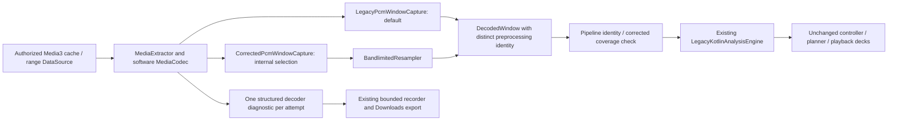

# AutoMix PCM decoding and resampling — Phase 2.2

Starting main: `3071ac58d57356246436c3e1c45b545dcc013ab4` (merged PR #16).
References: [Phase 1 investigation](BITCHORD_AUTOMIX_PORT_FEASIBILITY.md) and
[Phase 2.1 contracts](AUTOMIX_ANALYSIS_ENGINE_ARCHITECTURE.md).

## Scope and activation

**Legacy preprocessing remains the production default.** There is no user-facing
selector, second production analysis pass, new musical algorithm, native code,
model, playback/DSP change, EQ-session change, or version allocation.

`AndroidWindowDecoder(preprocessing = AnalysisPreprocessing.BANDLIMITED)` selects
the corrected path internally, principally for tests and future development.
`AnalysisPreprocessing.PRODUCTION` is `LEGACY`. Selection is an immutable constructor
value; MusicService derives the pipeline's preprocessing identity from that same
decoder, once per service host. Replacing the internal selection requires a new
decoder/pipeline and service lifecycle, not mutating an active job. Rollback is the
same constructor selection; no preference or stored data migration is involved.
Do not activate corrected preprocessing for ordinary playback until the Android
and source-access validation below passes on actual devices.

## Confirmed problems and limits of diagnosis

The legacy writer uses `floor((PTS-start)*22050/1e6)` and fills skipped output
indices with the last accepted frame's value. It has no anti-alias filter. Thus
high-frequency content can alias and materialized output can span missing source
audio. Its original numerical path and identifier remain intact for comparison.

The original decoder groups both requests shorter than four seconds and output
more than half a second short under `INSUFFICIENT_AUDIO_DATA`. This phase records
the guards separately. It also handles zero-sized EOS output without assuming a
non-null PCM ByteBuffer; zero-sized output carries no decoded audio evidence.

The supplied historical phone log cannot establish which codec/container/source
condition caused its truncated windows. This implementation does not claim to
have repaired those particular real-device failures. New telemetry is intended to
make the next investigation conclusive. It does not change source byte budgets,
retry counts, source authentication, or the musical analyzer's confidence gates.

## Pipeline



Both paths share the same existing extractor, codec, DataSource and deadlines.
There is no new executor. Conversion runs synchronously inside the existing
Efficient/Balanced/Performance workers (1/2/4), queue capacity 8, feature LRU 64.
Each job owns its PCM, kernel and capture state; no PCM enters the feature cache.

## Exact preprocessing contracts

| Property | Legacy | Corrected |
|---|---|---|
| Identifier | `nearest-time-mono-22050-v1` | `sinc64-blackman-mono-22050-v2` |
| Channel conversion | Original Float arithmetic mean | Double accumulator arithmetic mean, Float32 storage |
| Input | Existing PCM16 or Float32 decoder output | Native-endian interleaved PCM16 (`short/32768`) or finite Float32; 1–8 channels; 8–192 kHz |
| Conversion | Timestamp-index sample selection/repetition | Symmetric Blackman-windowed sinc, rational fractional positions |
| Output | Mono Float32, 22,050 Hz | Mono Float32, 22,050 Hz |
| Gaps | Repeated output possible; measured source coverage stays separate | Never synthesized across a source gap; controlled failure |
| Edges | Original repetition policy | Constant edge extension for FIR support, counted explicitly |
| Format change | Original path | Conservative `FORMAT_CHANGED` rejection; no unvalidated clock/rate splice |

Any material filter, downmix, edge, gap, phase or rounding change requires a new
corrected identifier. The old identifier must never be reused for changed PCM.

### Filter design

`BandlimitedResampler.kt` is an independent Kotlin implementation of the standard
windowed-sinc method, not copied BitChord/Orchard code. No extra production
library or license obligation is introduced. The only added dependency is the
Apache-2.0 AndroidX instrumentation runner, test scope only.

For ratio `r=min(1, outputRate/inputRate)`, the low-pass cutoff is `0.94*r` times
input Nyquist. Radius is `ceil(32/r)` source frames; width is `2*radius+1` taps.
The symmetric Blackman window is `0.42+0.5*cos(pi*x/radius)+0.08*cos(2*pi*x/radius)`.
Each of 1,024 fractional-phase kernels is DC-normalized; the nearest phase is
selected with at most 1/2048 input-frame position error. Output positions are
computed independently as `originOffset+n*inputRate/outputRate`; there is no
rounded integer output period or cumulative per-sample timestamp rounding.

Aligned identity-rate input is copied exactly. A fractional identity-rate origin
uses the same interpolating filter. The symmetric noncausal filter is evaluated
against the bounded captured region, so its group delay is compensated directly:
no delayed samples are presented at unshifted timestamps. Edge support clamps to
the first/last captured frame. `edgeSupportedOutputFrames` records that support;
these are not additional decoded source frames or inserted timeline audio.

Output frame count is the floor of supported duration times 22,050 Hz. The final
sub-frame remainder is omitted, never repeated to reach the requested length.
The kernel table is per window and bounded by the supported rates. Source PCM is
allocated once for at most 32 seconds plus two source frames, mono only. There
are no per-sample objects. Cancellation/deadline checkpoints occur during kernel
construction, source conversion every 512 frames, and output every 256 frames.

## Time and coverage semantics

All source intervals are absolute microseconds, start inclusive/end exclusive.
The requested interval remains unchanged. `decodeInterval` is the existing
extractor-duration/max-window clamp. Decoder output PTS and total decoded frames
include pre-sync/overlap material; accepted frames count only retained, distinct
source frames intersecting the interval. Resampled frame count is independent.

A codec buffer's PTS plus frame index/sample rate determines its source clock.
Contiguous buffers use one rational frame clock. PTS disagreement no greater than
one quarter source frame (minimum 2 microseconds) is treated as bounded timestamp
jitter, snapped to the contiguous clock and counted with its maximum correction.
This handles integer-microsecond codec rounding without accumulating drift.

Whole-frame overlap and identical repeated buffers are trimmed and counted.
A backward buffer PTS beyond the jitter policy is a timestamp-regression failure.
An actual forward gap is `SOURCE_GAP`; it is never bridged with silence, repeated
samples or time compression. The known contiguous prefix remains in diagnostic
coverage, and the job fails safely. Missing codec-format confirmation yields
`UNKNOWN` coverage, rather than invented confirmed PCM.

Pre-sync samples are trimmed with source-frame precision. One source frame that
straddles the start is usable filter support; reported source coverage is clipped
to the decode interval. A late first frame is not backfilled: the materialized
origin advances to the next millisecond inside the actual region, for compatibility
with the current legacy engine's millisecond origin API. This is explicitly
permitted only for corrected preprocessing. The original origin checks remain for
legacy/identity PCM. A future native engine still receives microsecond metadata.

A contiguous truncated tail may return a valid **partial DecodedWindow** with its
actual sample count, source coverage and EOS. An unknown or partially covered
corrected decode interval is rejected by `WindowAnalysisPipeline` before reaching
the planner. A request ending beyond known extractor duration remains partial
relative to the original request but can be complete relative to its legitimate
clamped decode interval. These cases are deliberately different. No confidence
threshold is relaxed to admit incomplete data.

### EOS and source limits

`codecEos` means an observed MediaCodec EOS flag. `inputEnd` independently records
natural extractor EOF versus the existing requested-boundary input EOS. A decoder
EOS is not automatically the file's natural end. Zero-size EOS buffers add zero
source frames. Requested/effective/accepted ends and extractor duration are all
reported, including a duration-minus-accepted-end delta when known.

Maximum window remains 32 seconds, minimum request four seconds, track duration
limit 30 minutes. Remote random access retains 3 MiB, fully cached 12 MiB, four
64-KiB blocks, and the existing HTTP Content-Range probe. No source provider,
authorization, full-song workaround, or retry expansion was added. Resources still
close in `finally` on success, failure, timeout and cancellation.

## Diagnostics: schema 2

The existing long-press Stats for Nerds → Downloads flow is unchanged. One new
`DECODER` event per decode attempt carries typed enums/numbers, attached to the
captured attempt ID/role/stage. Retried windows produce their own decoder events;
existing RETRY/RECOVERED events retain their meaning. A late job cannot attach its
details to a newer pair accidentally.

Fields include preprocessing identity, decoder stage/subtype/category, requested
and effective microsecond intervals, actual accepted intervals, coverage status,
codec output frames/first PTS/final observed frame end, accepted and materialized
frames, source rate/channels/encoding and whether codec-confirmed, target format,
EOS cause, duration provenance, range/cache status, bounded source bytes read,
elapsed time, repetition, overlap drops, jitter and filter-edge counts. null means
unknown/unobserved. No PCM, titles, artists, URLs, headers, cookies or exception
messages are accepted by this diagnostic model. Session-salted track hashes and
30-attempt × 128-event history bounds remain; interval/format rendering is capped.

Controlled subtypes distinguish request-too-short, truncated-window, empty-output,
source-gap, timestamp-regression, malformed-buffer, nonfinite-PCM, unsupported-PCM,
format-changed, source/range/byte-budget/codec-unavailable, deadline/cancellation,
and unclassified failures. Broad existing UI/retry categories remain compatible.
A failure subtype is not a claim about the historical phone log's cause.

Schema-1 event names, numeric fields and summary structure remain available in
schema 2; parsers should accept added DECODER fields and the incremented header.
There is no new export UI, public permission or unrestricted logcat dump.

## Version and cache isolation

`AnalysisProfile` already hashes backend ID/version, preprocessing version,
recording/rendition identity, window and detail. Both feature caching and in-flight
dedup use that key. Legacy/corrected keys therefore differ even for identical
tracks/windows. A pipeline validates its decoded window identity and preprocessing
against its immutable advertised profile. Mismatched results fail rather than
being relabeled. AnalysisMetadata and result validation retain preprocessing,
preparation metadata and the exact decoder diagnostic. Failed corrected windows
never become successful legacy planning results. The default backend remains
`tinium-legacy-kotlin`, version `5`; its confidence scale is still uncalibrated.

## Validation and measurements

The deterministic JVM suite covers passband, alias suppression, fractional origins,
phase/time alignment, impulses, DC, silence, multitone/sweep/noise, all named source
rates plus 192 kHz, boundary extension, source timestamps, overlap/gaps/jitter,
partial/unknown coverage, PCM16/float stereo, format failure, cancellation, profile
isolation, cache/in-flight isolation, diagnostics privacy and legacy compatibility.

Engineering acceptance gates, excluding finite-window edge transients:

- 1 kHz sine sample RMSE <0.0003 (0.5 amplitude), RMS error <0.0005 across rates.
- 8 kHz passband RMS error <0.001 for 32/44.1/48/96 kHz downsampling.
- 14 kHz stopband/aliased energy <−60 dB relative to original sine RMS.
- 8→22.05 kHz image at 7 kHz amplitude <0.0003 for a 1 kHz input.
- Centered impulse peak retains its exact 0.5-second timestamp; aligned identity
  output is bit-exact; duration uses integer floor, with no drift compensation trick.

Executed measurements and command details follow at the end of this document.

## Android validation and device procedure

`AndroidWindowDecoderInstrumentedTest` uses generated AAC 48-kHz stereo and FLAC
44.1-kHz mono fixtures (7-second 997-Hz tones, provenance in test assets README).
It exercises real extractor/software-codec output, both preprocessors, seeking,
EOS clamping, metadata, cancellation/deadline and repeated cleanup. Test assets and
runner are instrumentation-only, not production APK dependencies/assets.

No emulator or connected Android device is available in this cloud environment.
Compilation is not execution of these tests. In particular AAC delay/padding,
Samsung software codecs, float output, EOS timestamps and remote source delivery
remain unverified. No APK is created or published as part of this task.

After a future authorized private build, keep legacy production selection and
collect an uninterrupted baseline on the Galaxy S25 Ultra. Enable AutoMix and
Stats for Nerds using existing settings; long-press the existing overlay, then
share the Downloads report. Confirm schema 2, legacy preprocessing identity, each
window's requested/effective/accepted range, subtype, EOS cause and bytes. Repeat
local/downloaded, fully cached and streamed tracks, head/tail windows, seek/skip,
all worker modes and Poweramp/internal-EQ combinations. Distinguish expected seek
cancellations from decoding failures. No new UI setting activates the corrected
path. Activating it requires a later reviewed internal selection and private build.

For the corrected internal build, run the instrumentation class on a device first;
then compare the same permitted songs and their actual beat references. For range
sources separately test valid Content-Range, rejected ranges, short reads, cache
holes, timeouts and budget exhaustion without authentication/URL logging. Require
accurate actual coverage, no fabricated continuous windows, bounded bytes/time,
recoverable failures, normal playback, and stable external EQ/session behavior
before promotion. Listening or output capture is still needed for musical quality.

## Remaining work and Phase 2.3

Corrected PCM is consumable through the existing AnalysisEngine boundary. A future
native backend can use the actual Float32 sample rate, origin, coverage and
preprocessing identity without another decoder architecture rewrite. Licensing,
native cancellation/ABI/page-size safety and musical accuracy remain separate
Phase 2.3 gates. There is no BitChord code or binary in this implementation.

The integer-lag BPM estimator, onset-clock/beat-grid defects, confidence calibration,
key/vocal heuristics, planner gates and incoming-gain problem remain intentionally
unchanged. Anti-aliasing cannot fix those algorithms or guarantee intelligent
mixes. Mid-window source-format changes are safely rejected, not stitched. Real
gaps currently fail with useful prefix coverage rather than selecting/merging
segments. Decoder endpoint/duration inaccuracies are now observable, not assumed
fixed. Neither Android hardware performance nor battery/thermal behavior has been
measured here; retain legacy production until those gates are satisfied.

## Executed signal and desktop-JVM measurements

Measurements below use the GMS JVM test process (Java 21), generated signals and
no Android codec/network. They are observations from one invocation per case,
with JVM warmup, GC and concurrent Gradle load; they are not statistical Android
performance/battery benchmarks. The FOSS suite also executes these same tests.

| Input → 22,050 Hz | 8-kHz output RMS (ideal 0.35355339) | 14-kHz aliased output, dB relative to input |
|---|---:|---:|
| 32,000 Hz | 0.35353623 | -103.50 dB |
| 44,100 Hz | 0.35353776 | -117.99 dB |
| 48,000 Hz | 0.35353714 | -109.06 dB |
| 96,000 Hz | 0.35353715 | -109.06 dB |

Interior measurements exclude 1,024 output frames at each boundary. The worst
observed 8-kHz RMS error is approximately 0.0000172, well inside the 0.001 gate.
These suppression values measure the generated 14-kHz test tone, not every
possible stopband frequency or real source format. No claim about speaker,
Bluetooth or post-EQ output follows from analysis-PCM measurements.

| Source rate | Window | Legacy wall ms | Corrected wall ms | Legacy CPU ms | Corrected CPU ms |
|---|---:|---:|---:|---:|---:|
| 44,100 | 5s | 19.09 | 20.25 | 13.16 | 20.15 |
| 44,100 | 16s | 34.69 | 60.83 | 24.89 | 59.63 |
| 44,100 | 24s | 116.97 | 77.86 | 115.74 | 75.29 |
| 44,100 | 30s | 21.20 | 89.91 | 21.11 | 89.89 |
| 44,100 | 32s | 22.21 | 97.99 | 22.21 | 97.88 |
| 48,000 | 5s | 3.75 | 21.13 | 3.75 | 21.14 |
| 48,000 | 16s | 21.44 | 86.52 | 21.31 | 86.53 |
| 48,000 | 24s | 18.33 | 82.20 | 18.33 | 82.12 |
| 48,000 | 30s | 23.59 | 109.84 | 23.58 | 102.24 |
| 48,000 | 32s | 26.11 | 115.53 | 26.13 | 115.44 |

The harness includes capture/conversion/filter construction, excludes source
fixture generation, codec/network I/O and musical analysis. It does not measure
peak heap, allocation counts or Android cancellation latency. Array sizes are
known from actual frame counts; approximate live **core array storage by design**
for a 32-second corrected window is 8,995,592 bytes at 44.1 kHz and 9,543,944 bytes
at 48 kHz (source mono + output mono + FIR table). At the supported 192-kHz upper
bound it is 29,688,072 bytes; four concurrent windows could require about 113.3 MiB
for these arrays alone. This is a calculated bound, not a measured peak; codec,
range cache, temporary objects, GC and the rest of the app add more. Device memory
and thermal profiling remain promotion gates. The converter adds no threads.

### Musical benchmark through both preprocessors

Both paths used the same generated 48-kHz, 30-second groove per BPM, followed by
unchanged Kotlin SCAN analysis. F1 uses the Phase-2.1 one-to-one, no-phase-rotation,
no-octave-normalization evaluator on absolute beat positions. All seven generated
legacy/corrected cases still miss at least one future analyzer target; no input
correction is claimed to repair musical inference or confidence calibration.

| Ground truth | Legacy BPM / grid confidence | Corrected BPM / grid confidence | F1 at70ms legacy / corrected | F1 at30ms legacy / corrected |
|---|---|---|---|---|
| 90 | 60.000 / 0.2019 | 60.000 / 0.1932 | 0.400 / 0.400 | 0.400 / 0.400 |
| 107 | 107.143 / 0.2349 | 107.143 / 0.2339 | 1.000 / 1.000 | 1.000 / 1.000 |
| 120 | 120.000 / 0.3650 | 120.000 / 0.3598 | 1.000 / 1.000 | 1.000 / 1.000 |
| 128 | 85.714 / 0.0316 | 125.000 / 0.0000 | 0.080 / 0.220 | 0.000 / 0.085 |
| 140 | 142.857 / 0.0000 | 142.857 / 0.0000 | 0.288 / 0.288 | 0.106 / 0.106 |
| 150 | 150.000 / 0.3607 | 150.000 / 0.3572 | 1.000 / 1.000 | 1.000 / 1.000 |
| 174 | 176.471 / 0.0000 | 176.471 / 0.0000 | 0.405 / 0.380 | 0.147 / 0.147 |

Full JVM XML output also reports phase confidence, RMS, peak, tempo error, median
and p95 beat error, accumulated drift and unmet target codes for each case. For
example, 90 BPM is still misidentified at 60 BPM; 140 and 174 BPM retain integer-lag
quantization; corrected 128 BPM estimates 125 BPM but grid confidence is zero.
Thus the new resampler's strong signal-quality result does not establish a useful
beat grid. These are controlled fixtures, not accuracy results on the user's songs.

### Executed commands and boundaries

```sh
source /workspace/onboarding/activate.sh
bash gradlew \
  :app:testArm64GmsDebugUnitTest --tests 'com.music.vivi.playback.automix.*' --tests 'com.music.vivi.playback.effects.*' \
  :app:testUniversalFossDebugUnitTest --tests 'com.music.vivi.playback.automix.*' --tests 'com.music.vivi.playback.effects.*' \
  :app:compileUniversalGmsReleaseSources :app:compileUniversalFossReleaseSources \
  :app:compileArm64GmsDebugAndroidTestSources :app:compileUniversalFossDebugAndroidTestSources --no-daemon
```

Four Android instrumentation methods are implemented, including cancellation
during active decoding, but none were executed here. No emulator/device, test APK,
release APK, listening check, streaming/range integration execution or Galaxy S25
Ultra runtime check is available in this task. No benchmark creates an APK.
Underlying DataSource open/read timeouts remain those of the existing source
factory; cooperative checkpoints do not forcibly abort a blocking platform I/O
call. This remains a separate device/source validation concern.

### Final verification outcome

- GMS `testArm64GmsDebugUnitTest`: **190 focused tests executed**, 190 passed,
  zero failures/errors/skips. FOSS `testUniversalFossDebugUnitTest`: **190 focused
  tests executed**, 190 passed, zero failures/errors/skips. These are fresh XML
  results for AutoMix/effects, not stale unrelated test XML retained by Gradle.
- Both universal GMS/FOSS release Kotlin compilations executed successfully.
  Their aggregate `compile…ReleaseSources` tasks were up-to-date after prerequisite
  compilation; manifests, resources and unchanged Java/proto work reused valid
  outputs. No APK packaging/signing task was invoked.
- Both arm64 GMS and universal FOSS Android-test Kotlin compilations executed
  successfully; aggregate Android-test Sources tasks were up-to-date afterward.
  **Four instrumentation methods compiled; zero ran.** ADB cannot start with this
  container's read-only `/home/agent/.android`, and no emulator is installed.
  This is not an Android runtime pass or a skipped JVM test.
- `git diff --check` passed. Existing Kotlin/compiler deprecation warnings remain;
  no unrelated lint cleanup or dependency upgrade was attempted.
- Earlier local validation caught and corrected a test-only ByteBuffer return-type
  issue. A combined command initially placed `--tests` after a compile task; that
  command failed configuration before compilation and was corrected to the
  task-scoped command above. The final combined command exited successfully.

## Pre-merge validation follow-up

The [final validation review](AUTOMIX_PHASE22_FINAL_VALIDATION.md) records the
follow-up buffer/EOS fixes, deterministic active-decode cancellation test,
maximum-rate four-worker JVM stress check, cache review, and exact S25 Ultra test
commands. Use `-PautomixDecoderTests=true` for connected device tests to install an
isolated **debug target** (`com.yren411.tinium.decodercheck`) alongside your beta.
This test-only packaging option changes neither normal app IDs/signing nor the
legacy production preprocessing default. Four instrumentation methods still
require Android execution; compilation is not a runtime pass.
